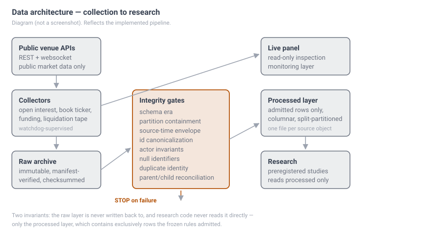

# Quant Market Research

Independent research on crypto derivatives market microstructure, execution
cost, and DeFi liquidity.

I build data infrastructure, register hypotheses before testing them, and
publish the results — including the ones that failed. Most of my completed
studies are negative. That is the honest state of the work.

---

## Projects

### OI-VOL

Multi-exchange open-interest, volume and order-flow monitoring, with a
research layer on top.

- **Data sources** — public market data only. Venue connectors developed for
  Binance, Bitget, Bybit, Coinbase, Gate.io, Kraken and MEXC; the standalone
  deep-collection package is Binance USDT-M only
- **Infrastructure** — collectors for open interest, book ticker, funding
  settlements and the liquidation tape; a local time-series archive with a
  never-prune history layer; watchdog and liveness supervision; a FastAPI
  panel for live inspection
- **Research layer** — anomaly *candidate generation* over OI/volume/price,
  with each candidate rule registered before it is evaluated
- **Status** — designed for continuous collection on a personal research
  host, with documented gaps caused by host sleep and network interruptions.
  **No candidate rule has been validated as predictive.** Several have been
  formally rejected.

### Whale Lab

Execution-state prediction for large TWAP parent orders on Hyperliquid.

- **Question** — given that a TWAP parent order is still live at time *t*,
  which terminal state will it reach, when, and how much more size will
  execute before it does?
- **Not a returns study.** Price, P&L and markouts are out of scope by
  preregistration.
- **Status** — the first confirmatory attempt **failed its data-integrity
  gates and is recorded as failed**. A second preregistration is frozen and
  tagged; no model has been fitted and the prospective test has not started.

See [docs/oi-vol.md](docs/oi-vol.md) and [docs/whale-lab.md](docs/whale-lab.md).

---

## Architecture



Two invariants hold across the pipeline: the raw archive is never written
back to, and research code never reads it directly — every study reads the
processed layer, only after the integrity gates.

Full detail: [docs/architecture.md](docs/architecture.md).

---

## Research process

```
hypothesis
   -> preregistration        (question, stopping rule, reading rule — committed and tagged first)
   -> historical development (TRAIN / VALIDATION only)
   -> validation             (selection and calibration, never refitting on everything)
   -> freeze                 (model and pipeline tagged; nothing changes after this)
   -> prospective test       (one window, one read)
   -> accept / reject        (by the rule written before the data existed)
```

Two properties matter more than the pipeline shape:

- **A stopping rule that fires closes the family.** It is not renegotiated
  after seeing the number.
- **Integrity gates block.** If a gate fails, the study stops and the failure
  is published. Nothing is repaired to make a result appear.

Full detail: [docs/research-method.md](docs/research-method.md).

---

## Selected research

| study | result | status |
|---|---|---|
| Perp–spot basis dislocation | A small directional effect appeared in validation (+3.78 bps), weakened materially in the frozen holdout (+1.23 bps, CI touching zero), and stayed far below the 58 bps round-trip hurdle throughout. The stopping rule fired and closed the directional perp-microstructure family. | **NULL** |
| Post-settlement funding unwind | The tradeable hypothesis died on a 45 bps hurdle. Something *is* detectable at settlement, and it points the opposite way. | **NULL** |
| Whale Lab E2 (v1.1) | Failed Gate F and the reconciliation gate. Recorded as failed; not repaired or re-scored. | **FAILED INTEGRITY** |
| Whale Lab E2 (v2) | Preregistration frozen and tagged. 30-day prospective confirmation window, not yet begun. | **PROSPECTIVE** |
| OFI Engine | Depth-normalized order-flow imbalance; measurement infrastructure past its Phase-1 gate. | **DEVELOPMENT** |
| Kronos 24h direction forecast | Pre-registered. No edge after fees. See [`kronos-24h-forecast/`](kronos-24h-forecast/). | **DROP** |
| Uniswap v3 liquidity recovery pilot | Pre-registered. How fast in-range depth recovers after large ETH/USDC moves, by fee tier and chain. H1 (fee tier) No, H2-Arbitrum No, H2-Base Null. See [`uniswap-liquidity-pilot/`](uniswap-liquidity-pilot/). | **NO / NULL** |
| Hyperliquid vs Binance funding gap | Pre-registered. Pairs opened on a large funding gap lost 63.8 bps per pair on average after 84 bps costs (z −11.0); the gap usually closed within about a day, so pairs collected only +19.8 bps of funding. See [`funding-gap-hl-binance/`](funding-gap-hl-binance/). | **FAIL** |
| Cross-coin momentum on Binance perps | Pre-registered. Weekly long the top third / short the bottom third of coins by 28-day return. Net −0.6 bps per week (Newey-West t −0.01): costs of about 32 bps per week ate the +31.6 bps gross return. See [`cross-coin-momentum/`](cross-coin-momentum/). | **FAIL** |

**Worked example — preregistration to null result:**
[research/basis-dislocation/](research/basis-dislocation/) contains the
preregistration, the findings, and a
[provenance note](research/basis-dislocation/PROVENANCE.md) stating plainly
what a public reader can and cannot verify. Both documents are published
verbatim — the study used public market-data archives only, so nothing
required redaction.

> **Current interpretation:** The original findings document uses the word
> "reliably" for the validation result (+3.78 bps). A subsequently opened
> frozen historical holdout showed a smaller **+1.23 bps** effect with a 90%
> CI of **[−0.04, +2.50]**, spanning zero. I therefore do not describe the
> effect as confirmed, prospective, or reliably replicated. The holdout data
> already existed when the preregistration was written — it was untouched
> until after the validation verdict was frozen, not collected afterwards.
> The holdout weakened the result, and the economic verdict is dead either
> way: both estimates sit far below the 58 bps round-trip hurdle.

Detail and method for each: [docs/experiments.md](docs/experiments.md).

---

## Current status

> **No trading edge presented here should currently be considered validated.**

To be specific about what that means:

- No model has been fitted in Whale Lab.
- No prospective test has run to completion.
- Every completed study is a null result, a killed hypothesis, or an
  integrity failure.
- The forensic work on Whale Lab explains a *data-integrity* failure. It is
  not a predictive result and must not be read as one.

---

## Technical stack

Python, pyarrow / Parquet, SQLite (WAL), FastAPI, pytest, `websockets`,
S3-backed archives with requester-pays access, Windows and Linux collectors
under watchdog supervision, decimal-exact reconciliation arithmetic,
SHA-256 provenance manifests.

---

## Public vs private

**Public** — research method, preregistrations, findings including failures,
architecture, generic venue collectors, tests.

**Private** — live execution code, position management, alert thresholds and
scoring constants, credentials, server topology, account identifiers, and
raw archives whose redistribution licensing is unclear.

The boundary is deliberate: the *method* is the contribution, and the
operational specifics are not useful to a reader while being harmful to
expose.

---

## Collaboration and funding

Support would fund infrastructure, not trading capital:

- **Compute** — integrity reprocessing currently runs in multi-hour passes on
  a single laptop
- **Storage** — one study alone occupies roughly 85 GB of archived source data
- **Data** — requester-pays archive egress and venue data access
- **Prospective experiments** — running frozen protocols to completion
- **Research software** — the acceptance and provenance tooling that makes
  results auditable

Roadmap and use of funds: [docs/funding-roadmap.md](docs/funding-roadmap.md).

**Research funding:** [View the one-page funding brief](docs/funding-brief.pdf)

---

## License

Documentation and research documents in this repository are licensed under
[**CC BY 4.0**](https://creativecommons.org/licenses/by/4.0/). You may share
and adapt them, including commercially, with attribution and a link to the
license, indicating if changes were made. See [LICENSE](LICENSE).

The preregistration and findings documents are published as **historical
records** and are byte-identical to their private originals. Exception:
`kronos-24h-forecast/AMENDMENTS_kronos.md` is a redacted copy (private
operator details only); its README explains this. If you quote or
build on them, please preserve their dates and verdicts — their value is that
they were written before the results existed.

The code in [`kronos-24h-forecast/`](kronos-24h-forecast/) (its Python
scripts and Colab notebook) is MIT-licensed — see
[`kronos-24h-forecast/LICENSE`](kronos-24h-forecast/LICENSE). No other software
source code is distributed here.

---

## Disclaimer

Research software. **Not financial advice, not an offer, not a signal
service, and not a claim of profitability.** Nothing in this repository
should be used to make trading decisions.
