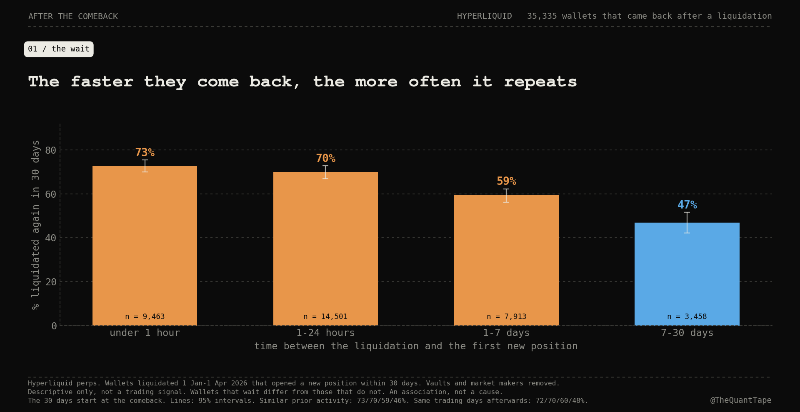
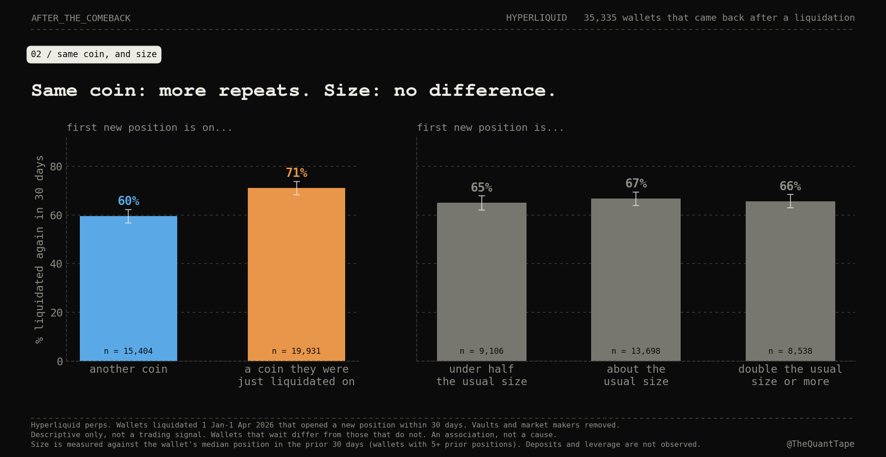

# After the Comeback

**When a liquidated wallet starts trading again, does how it comes back go with being liquidated again?**

We followed 35,335 Hyperliquid wallets that were liquidated between 1 Jan and 1 Apr 2026 and opened a new position within 30 days. For each one we looked at the 30 days after that comeback. This is a descriptive study. It is not a trading strategy, and it shows what goes together, not what causes what.

It is a follow-up to [Life After Liquidation](../life-after-liquidation/), which compared liquidated wallets with similar wallets that were not liquidated. Here, liquidated wallets are compared with each other.

## Key findings

1. **Two in three are liquidated again.** 66.0% of wallets that came back were liquidated again within 30 days of coming back, and 48.6% within 7 days.
2. **The faster the comeback, the more often it repeats.** Wallets that opened a new position within an hour were liquidated again 72.6% of the time. Wallets that waited 7 to 30 days: 46.8%. The gap is 26 points, and it is about the same at similar prior activity and size (28 points), for fully wiped wallets (25 points) and for partly liquidated ones (27 points).
3. **Going back to the same coin goes with more repeats.** When the first new position was on a coin the wallet had just been liquidated on, 71.1% were liquidated again, against 59.5% on another coin. The 12-point gap holds in every split.
4. **The size of the first new position shows no clear difference.** Under half the usual size, about the usual size, or double and more: 65.0%, 66.7% and 65.6%.
5. **It is not only that fast returners trade more.** They do trade on more days afterwards (median 10 days against 4). But comparing wallets with the same number of trading days after the comeback, the gap is still 24 points.\*

\*Extra check added after the main results, at reviewers' request. See "Extra check" below.

**How to read this.** These are associations. Nothing here shows that waiting protects a wallet, or that the same coin is riskier. Wallets that wait may simply be more careful, hold less leverage, or have less money left. Leverage, deposits and account size are not in the data. The results cover only wallets that came back within 30 days.

## Full results

**Who is counted**

| Step | Wallets |
|---|---|
| Liquidated wallets in the earlier study (1 Jan – 30 Apr 2026, one event each) | 54,180 |
| Dropped: event ended on or after 2 Apr 2026 | 12,812 |
| Left | 41,368 |
| Never opened a new position within 30 days | 6,033 (14.6%) |
| **Came back, kept** | **35,335** |

Events from 2 April on are dropped for everyone, so that every wallet has a full 30 days to come back and a full 30 days of data after that. Of the 35,335, 20,478 were fully wiped by the liquidation and 14,857 partly liquidated.

"Liquidated again" means a new liquidation starting in the 30 days after the comeback. Liquidation fills less than 60 minutes apart count as one liquidation, as in the earlier study. The clock starts at the comeback, so fast and slow returners get the same time.

**A. Wait before the comeback**

| Wait | Wallets | Liquidated again in 30 days [95% CI] | At similar prior activity and size | Fully wiped | Partly liquidated | Within 7 days |
|---|---|---|---|---|---|---|
| Under 1 hour | 9,463 | 72.6% [69.9, 75.4] | 73.2% | 75.3% | 68.6% | 56.9% |
| 1–24 hours | 14,501 | 70.0% [67.0, 72.8] | 70.2% | 72.7% | 66.7% | 51.3% |
| 1–7 days | 7,913 | 59.3% [56.2, 62.3] | 58.6% | 62.1% | 55.6% | 41.1% |
| 7–30 days | 3,458 | 46.8% [42.2, 51.6] | 45.5% | 49.7% | 41.3% | 31.6% |
| Gap, first minus last | | +25.9 [21.6, 30.1] | +27.6 [24.0, 31.2] | +25.5 [20.3, 30.8] | +27.3 [22.9, 31.7] | +25.2 [19.4, 30.8] |

The last group stops at 30 days by construction: wallets that waited longer are not in the study.

The same order shows inside other groups:

| | Under 1 hour | 1–24 hours | 1–7 days | 7–30 days |
|---|---|---|---|---|
| Came back on the same coin | 74.3% | 72.7% | 65.7% | 56.2% |
| Came back on another coin | 68.1% | 66.3% | 54.6% | 41.6% |
| First position under 0.5× usual | 72.7% | 70.2% | 57.4% | 43.4% |
| First position 0.5–2× usual | 73.3% | 70.0% | 59.6% | 44.4% |
| First position 2× usual or more | 70.8% | 68.9% | 57.7% | 45.6% |
| Traded on 3–9 of the prior 30 days | 75.5% | 72.5% | 61.5% | 50.7% |
| Traded on 10–19 | 68.6% | 67.1% | 56.3% | 45.7% |
| Traded on 20–30 | 68.8% | 65.4% | 51.9% | 15.9% (n = 290) |

**C. Same coin**

| First new position | Wallets | Liquidated again in 30 days [95% CI] | At similar prior activity and size | Fully wiped | Partly liquidated | Within 7 days |
|---|---|---|---|---|---|---|
| On a coin just liquidated | 19,931 | 71.1% [68.3, 73.8] | 71.0% | 72.7% | 67.4% | 54.8% |
| On another coin | 15,404 | 59.5% [56.7, 62.3] | 59.7% | 60.1% | 59.0% | 40.6% |
| Gap | | +11.6 [10.5, 12.6] | +11.3 [10.3, 12.3] | +12.5 [10.8, 14.4] | +8.4 [7.0, 9.7] | +14.2 [12.9, 15.5] |

Among those liquidated again, it also came sooner on the same coin: a median of 45 hours after the comeback, against 82 hours.

**B. Size of the first new position** (31,342 wallets with at least 5 positions in the prior 30 days)

| First new position against the wallet's usual size | Wallets | Liquidated again in 30 days [95% CI] |
|---|---|---|
| Under 0.5× | 9,106 | 65.0% [62.1, 67.8] |
| 0.5–2× | 13,698 | 66.7% [63.9, 69.4] |
| 2× or more | 8,538 | 65.6% [62.9, 68.4] |
| Gap, last minus first | | +0.7 [−1.3, 2.5] |

At similar prior activity and size the gap is +1.0 [−0.9, 2.8]. For fully wiped wallets it is +2.4 [0.2, 4.5], still under the 5-point threshold. "Usual size" is the wallet's median new position in the 30 days before the liquidation. A larger first position may mean fresh money was deposited, which we cannot see.

**The reading rule, fixed before the run.** A difference is called "goes with" only if the gap is at least 5 points and its 95% interval excludes zero in three places: all wallets, all wallets at similar prior activity and size, and fully wiped wallets. Wait and same coin meet it. Size does not. This is a pre-set descriptive threshold, not a significance test or proof of a meaningful effect.

Intervals come from 2,000 bootstrap draws of whole event days. "Similar prior activity and size" means the same mix of prior-30-day trading days (3–9, 10–19, 20–30) and prior-30-day traded volume (under $10k, $10k–$1M, over $1M) in every group. The full output is in `atc_report.txt`.

## Extra check (exploratory)

Added after the main results, because two reviewers raised the same doubt: fast returners also trade on more days afterwards (median 10 trading days in the next 30, against 9, 7 and 4 for the slower groups), and more trading means more chances to be liquidated. The rules for this check, including how the answer would be read, were written to the rules log before it ran.

Wallets were put into bands by the number of days they traded on in the 30 days after the comeback (0–2, 3–7, 8–14, 15–30). The repeat rate was computed inside each band and averaged with the same weights for every group.

| Wait | Raw | With the same trading days afterwards [95% CI] |
|---|---|---|
| Under 1 hour | 72.6% | 71.8% [68.9, 74.3] |
| 1–24 hours | 70.0% | 69.5% [66.5, 72.1] |
| 1–7 days | 59.3% | 59.9% [56.9, 62.8] |
| 7–30 days | 46.8% | 48.2% [43.6, 53.3] |
| Gap | +25.9 | +23.6 [18.7, 28.1] |

The order also shows inside every band. For example, among wallets that traded on 15–30 days after the comeback: 77.7%, 74.1%, 63.7% and 52.9%.

For same coin against another coin, the gap with the same trading days afterwards is +12.3 [11.2, 13.4], against +11.6 raw.

One caution: trading after the comeback can itself be changed by a liquidation, since a wallet that is liquidated early may stop. So this check adjusts for something that is partly a result, and it is not a clean control. Full output is in `atcx_report.txt`.

## How it was done

- **Data:** the tables built for [Life After Liquidation](../life-after-liquidation/), reused read-only: every liquidation fill on Hyperliquid perps from 1 Dec 2025 to 31 May 2026, and each liquidated wallet's first new position. Vaults and market makers were already removed.
- **Pre-registration:** the plan was reviewed, changed and frozen in a rules log before any code was written. The script was tested on made-up data first. Results were opened only after all checks had passed.
- **Checks, all passed before any result was read:**
  - 54,180 events, and 80.5% with a new position within 30 days, matching the earlier study.
  - The same outcome code, started from the liquidation instead of the comeback, reproduces the earlier study's result for every one of the 54,180 wallets (52.4% overall).
  - Dropped and kept wallets add up to 54,180.
  - 20 random wallets were recounted one by one from raw liquidation fills by separate code, and all matched.
  - Every wallet has a wiped or partial label.
- **A bug, found and fixed.** On the first read, the "fully wiped" rows were identical to the "all wallets" rows: the script had misread the wiped label. One line was fixed and the script rerun. Every number outside the wiped and partial rows was identical in both runs, and no verdict changed. The check on that label was made stricter.

## Limits

- **Association, not cause.** Wallets that wait differ from wallets that do not, in ways we cannot see. Nothing here shows that waiting, or switching coin, lowers anyone's risk.
- **Not observed.** Leverage, deposits, withdrawals and account size.
- **Returners only.** The 14.6% that did not come back within 30 days are not in the comparisons.
- **Still trading.** A wallet that stops after the comeback cannot be liquidated again. The extra check addresses this only partly.
- **Wallets, not people.** One trader can use several wallets, and bots are only partly filtered.
- **Scope.** One exchange, three months of liquidations; results may not hold elsewhere.

Prior work: [Life After Liquidation](../life-after-liquidation/) found that 52.4% of liquidated wallets were liquidated again within 30 days, against 17.1% of similar wallets. [Serial Liquidators](../serial-liquidators/) found that a third of liquidated wallets account for three quarters of all liquidation days. We did not find a published comparison of liquidated wallets by how they came back, after a limited search.
