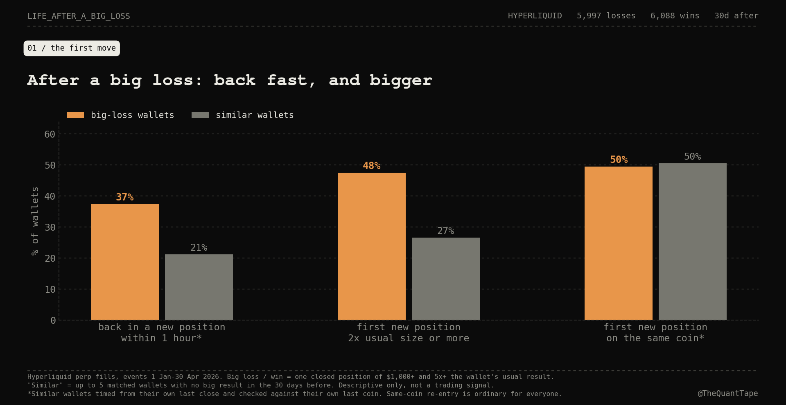
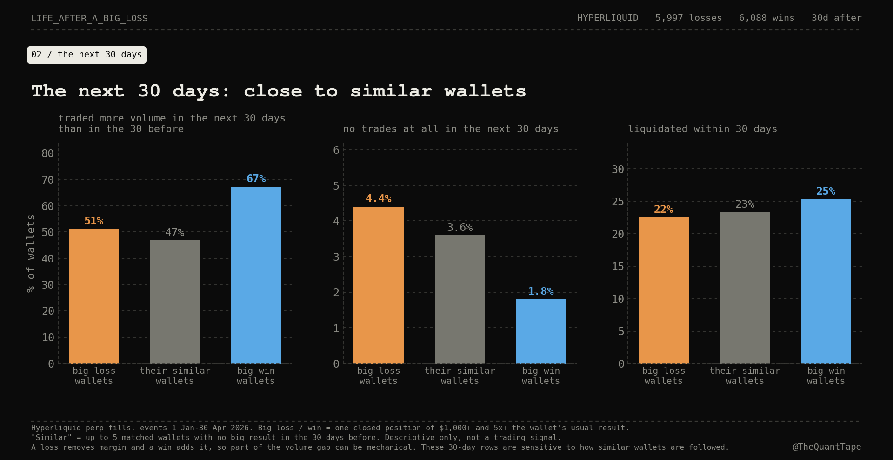

# Life After a Big Loss

**What do Hyperliquid wallets do in the 30 days after an unusually big loss?**

This is part 2 of [Life After a Big Win](../life-after-big-win/). It is the same study read from the other side: the 5,997 wallets that closed an unusually large losing position on Hyperliquid between 1 Jan and 30 Apr 2026. Each one is compared with up to 5 similar wallets that had no big result in the 30 days before, and with the 6,088 big-win wallets from part 1.

No new analysis was run for this write-up. The big-loss group was the secondary analysis of the Big Win plan, built with the same rules mirrored, and every number here comes from the reports of that run. It is a descriptive study of behaviour. It is not a trading strategy, and it shows what happens after a big loss, not why.

A "big loss" here is one closed position that lost at least $1,000 and at least 5 times the wallet's usual result, with no liquidation fill. The data cannot show how big it was against the account.

## Key findings

1. **More than one in three is back in a new trade within an hour.** 37.3% of big-loss wallets open a new position within an hour of closing the loss. Similar wallets, timed from their own last close, do so 21.2% of the time.\* (Followed from the event wallet's moment instead, as in the main table, they are at 13.8%; the own-clock figure is the fairer one.) The typical wait is about 3 hours, against about 12.
2. **The first trade back is often bigger.** For 47.5% the first new position is 2× their usual size or more (similar wallets: 26.6%).
3. **That is not special to losing.** Big-win wallets do almost exactly the same (34.8% back within an hour, 48.1% at 2× size). A direct comparison of the two gaps finds no difference (0.0 and +0.4 points).\* The data does not support reading the fast, larger re-entry as a reaction to losing in particular.
4. **Going back to the same coin is ordinary.** Half go straight back to the coin they just lost on (49.5%). Similar wallets go back to the coin of their own last trade just as often (50.5%).\* (Checked against the event wallet's coin, as in the main table, they are at 16.6%, which is not a like-for-like comparison.)
5. **Over the next 30 days the gaps to similar wallets are small.** 51.2% trade more volume in the next 30 days than in the 30 before, against 46.8% of similar wallets. Big-win wallets: 67.2%. Their typical new position is 1.07× what it was before (similar wallets: 0.99×, big-win wallets: 1.23×).
6. **Few go quiet.** 4.4% have no fills in the next 30 days, against 3.6% of similar wallets and 1.8% of big-win wallets. 92.9% are back in a new position within 30 days.
7. **Liquidation risk is about the same.** 22.5% are liquidated within 30 days, against 23.3% of similar wallets.

\*Extra checks added after the main results. See part 1, "Extra checks".

## Full results

Difference = big-loss wallets minus their similar wallets, in percentage points unless stated. 95% intervals come from 2,000 bootstrap draws of whole event days. 5,771 of the 5,997 events have similar wallets.

| Measure | Big-loss wallets | Similar | Difference [95% CI] |
|---|---|---|---|
| New position within 1 hour‡ | 37.3% | 13.8% | +23.5 [22.0, 25.0] |
| New position within 1 day‡ | 68.4% | 62.2% | +6.2 [4.7, 7.6] |
| New position within 7 days | 86.6% | 88.6% | −2.0 [−3.1, −1.0] |
| New position within 30 days | 92.9% | 94.9% | −2.0 [−2.7, −1.2] |
| Median hours to the first new position | 3.2 h | 12.4 h | −9.2 h [−10.0, −8.5] |
| First new position ≥ 2× usual size† | 47.5% | 26.6% | +20.9 [19.3, 22.5] |
| Median new-position size, after ÷ before† | 1.07 | 0.99 | +0.08 [0.05, 0.11] |
| More notional after than before | 51.2% | 46.8% | +4.4 [2.8, 6.1] |
| Change in active days (after − before) | +0.7 | +1.1 | −0.4 days [−0.6, −0.1] |
| Liquidated within 7 days | 9.8% | 10.0% | −0.2 [−1.2, 0.8] |
| Liquidated within 30 days | 22.5% | 23.3% | −0.9 [−2.0, 0.3] |
| No fills for 30 days | 4.4% | 3.6% | +0.8 [0.2, 1.4] |
| First new position on the same coin‡ | 49.6% | 16.6% | +33.0 [31.5, 34.5] |
| …same coin and same side‡ | 34.1% | 9.2% | +24.9 [23.5, 26.2] |

†Only wallets with at least 5 new positions in the prior 30 days.

‡Similar wallets are measured here on the event wallet's clock and coin, which overstates the gap. Re-timed from their own last close (exploratory check 2 of part 1):

| Measure | Big-loss wallets | Similar (own clock) | Difference [95% CI] |
|---|---|---|---|
| New position within 1 hour | 37.3% | 21.2% | +16.0 [14.6, 17.4] |
| New position within 1 day | 68.4% | 64.7% | +3.7 [2.4, 5.1] |
| First new position on the same coin | 49.5% | 50.5% | −0.9 [−2.5, 0.6] |
| Median hours to the first new position | 3.2 h | 12.5 h | — |

**Second run.** A similar wallet that later has its own big result stays in the numbers above. In a second run it is followed only up to that point. The re-entry results do not move. The rows that cover the whole 30 days do: the notional gap goes from +4.4 to +17.0, active days from −0.4 to +1.4, and 30-day liquidation from −0.9 to −3.9 [−5.2, −2.7]. Those rows depend on how the comparison wallets are handled, so we do not lean on them.

## Splits fixed in advance

These splits were fixed in the plan before any code ran. The fast, larger re-entry shows in every one. Which rows to show here was chosen after seeing the results, so treat this table as a description, not a test:

| Split | Events | Back within 1 hour | No fills for 30 days (similar) |
|---|---|---|---|
| Loss $1k–$5k | 4,494 | 38.3% | 4.4% (3.5%) |
| Loss $5k–$25k | 1,001 | 33.4% | 4.4% (4.2%) |
| Loss over $25k | 276 | 34.8% | 5.1% (2.6%) |
| Loss large against prior volume | 2,906 | 33.5% | 5.8% (4.1%) |
| Loss small against prior volume | 2,865 | 41.1% | 3.0% (3.1%) |
| Position held under 1 day | 2,283 | 40.3% | 3.6% (4.1%) |
| Position held 1 day or longer | 3,488 | 35.3% | 4.9% (3.3%) |

Wallets go quiet a little more often when the loss was large against what they usually trade, or came from a position held a day or longer. The differences are small (1 to 2 points). All splits are in `step5_report.txt` in part 1.

## "Winning it back" (exploratory)

15.6% of big-loss wallets win the whole loss back within 30 days, and 20.6% win back at least half. Similar wallets make that same amount 9.8% and 14.5% of the time.

Read this with care. Wallets picked for an unusually bad result will look better afterwards by chance alone, and this study cannot separate that from a change in behaviour. It counts realised profit only, so "winning it back" means the realised result, not the account. It was marked exploratory before any code ran, and it is not a headline.

## How it was done

The method, checks and pre-registration are those of [part 1](../life-after-big-win/), with the event rule mirrored: a wallet's first closed position between 1 Jan and 30 Apr 2026 with a result of −$1,000 or worse and −5× the wallet's usual result or worse, with no liquidation fill in it, no other big result and no liquidation in the prior 30 days. The reports this write-up reads are in part 1: `step5_report.txt`, `step5x_report.txt` and `step6x_report.txt`.

## Limits

All the limits of part 1 apply. The ones that matter most here:

- **Association, not cause.** Nothing here shows that losing makes traders chase losses. It shows what the same wallets did next, and winners did the same.
- **Two clocks.** In the main table a similar wallet is followed from the event wallet's moment and checked against the event wallet's coin, which overstates the 1-hour, 1-day and same-coin gaps (13.8% and 16.6% for similar wallets). The key findings use the own-clock figures instead (21.2% and 50.5%). The other rows have not been re-timed.
- **Not the same traders to begin with.** Similar wallets match on active days and profit (12.2 vs 12.8 days, 58% vs 57% in profit), but big-loss wallets traded about 49% more notional before the event ($680k vs $458k median) and had a larger usual result ($106 vs $84).
- **Volatile markets.** Big losses cluster on volatile coins and days, which also invite a fast return. Fast re-entry may reflect the market at that moment as much as the wallet.
- **The 30-day rows are fragile.** Volume, active days and 30-day liquidation change sign or size in the second run, so they depend on how comparison wallets are handled.
- **Margin.** A loss removes margin. Trading less after a loss than after a win can be partly mechanical.
- **The loss is realised, not the first pain.** The clock starts when the position is closed. A wallet may have been deep in loss on paper for days before that.
- **No liquidations.** Positions closed by liquidation are left out of this group. Those are covered in [Life After Liquidation](../life-after-liquidation/).
- **Already seen.** These numbers were computed and read together with part 1. This is a second write-up, not a second test.
- **Overlap.** 556 wallets appear once as a big-win event and once as a big-loss event, at different times, so the two groups are not fully independent.
- **Coverage.** 226 loss events had no similar wallet and are left out of the comparisons.
- **No account size, realised profit only, wallets not people, one exchange and four months.**
