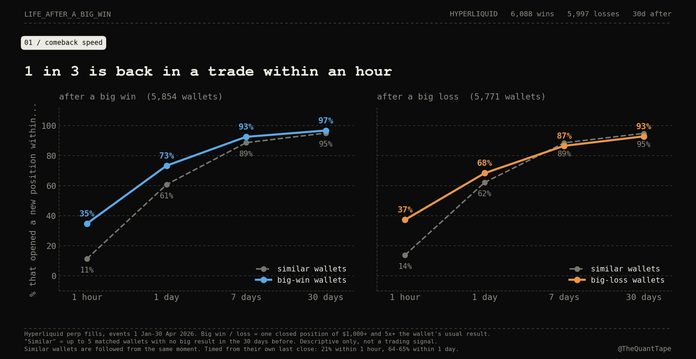
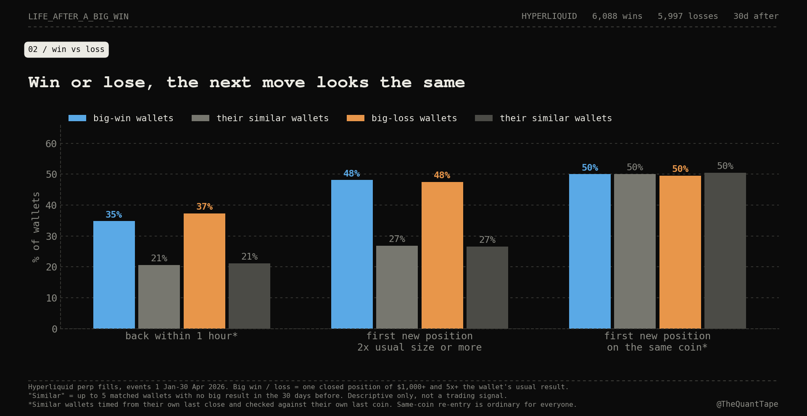
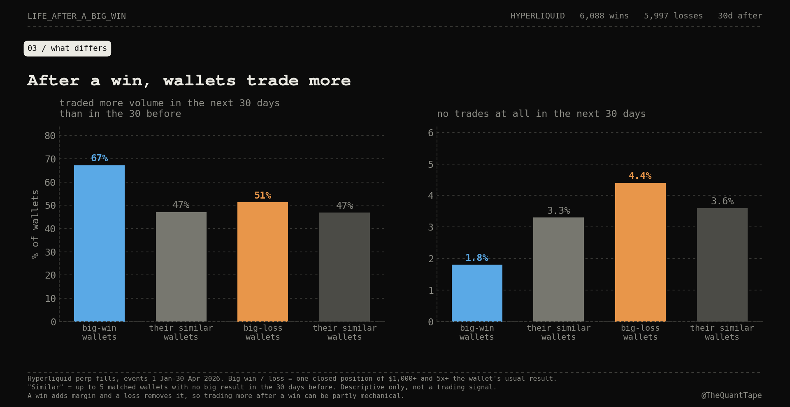

# Life After a Big Win

**What do Hyperliquid wallets do in the 30 days after an unusually big win?**

We followed 6,088 wallets that closed an unusually large winning position on Hyperliquid between 1 Jan and 30 Apr 2026, and a mirror group of 5,997 wallets that closed an unusually large loss. Each one was compared with up to 5 similar wallets that had no big result in the 30 days before: 52,589 comparison wallets in all. This is a descriptive study of behaviour. It is not a trading strategy, and it shows what happens after a big result, not why.

A "big win" here is one closed position that made at least $1,000 and at least 5 times the wallet's usual result. We call it a large realised-profit shock, because the data cannot show how big it was against the account.

## Key findings

1. **One in three is back in a new trade within an hour.** 34.8% of big-win wallets open a new position within an hour of closing the win. Similar wallets, timed from their own last close, do so 20.6% of the time.\* The typical wait is about 4 hours, against about 14.
2. **The first trade back is often bigger.** For 48.1% the first new position is 2× their usual size or more (similar wallets: 26.8%).
3. **None of that is special to winning.** Wallets that just took a big *loss* do almost exactly the same: 37.3% are back within an hour and 47.5% come back at 2× size. A direct comparison of the two gaps finds no difference (0.0 and +0.4 points).\* These look like "after any big result" habits.
4. **Going back to the same coin is ordinary.** Half of big-win wallets go straight back to the coin they just won on (50.0%). But similar wallets go back to the coin of their own last trade just as often (50.1%).\* It says nothing about winning or losing.
5. **What differs after a win: wallets trade more.** 67.2% trade more volume in the next 30 days than in the 30 before, against 47.1% of similar wallets and 51.2% of big-loss wallets. They add about 3 active days (similar wallets: 1.3). Their typical new position is 1.23× what it was before (big-loss wallets: 1.07×, similar wallets: 0.99×).
6. **Almost none go quiet.** 1.8% have no fills in the next 30 days, against 3.3% of similar wallets and 4.4% of big-loss wallets.
7. **Liquidation risk is about the same.** 25.3% are liquidated within 30 days, against 23.4% of similar wallets. The 2-point gap disappears in a stricter second run, so we do not lean on it.

\*Extra checks added after the main results. See "Extra checks" below.

**How to read the two comparisons.** The win-versus-loss comparison is the fair one: both groups have just closed a position at the same kind of moment. The comparison with similar wallets in the main tables is rougher. There, a similar wallet is followed from the event wallet's moment, although its own last close was up to 24 hours earlier, and it is checked against the event wallet's coin. The second extra check re-times similar wallets from their own last close: the 1-hour gap shrinks from 23.5 to 14.2 points, and the same-coin gap disappears. The main tables are left as they were computed.

## Full results

Difference = event wallets minus their similar wallets, in percentage points unless stated. 95% intervals come from 2,000 bootstrap draws of whole event days, keeping each event with its comparison wallets.

**Big wins** (5,854 events with similar wallets)

| Measure | Big-win wallets | Similar | Difference [95% CI] |
|---|---|---|---|
| New position within 1 hour‡ | 34.8% | 11.4% | +23.5 [22.1, 24.8] |
| New position within 1 day‡ | 73.4% | 60.8% | +12.7 [11.3, 14.0] |
| New position within 7 days | 92.6% | 88.7% | +3.9 [3.0, 4.7] |
| New position within 30 days | 96.8% | 95.1% | +1.7 [1.1, 2.2] |
| Median hours to the first new position | 4.1 h | 13.7 h | −9.7 h [−10.4, −9.0] |
| First new position ≥ 2× usual size† | 48.1% | 26.8% | +21.3 [19.9, 22.9] |
| Median new-position size, after ÷ before† | 1.23 | 0.99 | +0.24 [0.21, 0.28] |
| More notional after than before | 67.2% | 47.1% | +20.0 [18.7, 21.4] |
| Change in active days (after − before) | +3.0 | +1.3 | +1.7 days [1.5, 2.0] |
| Liquidated within 7 days | 10.8% | 10.0% | +0.8 [−0.1, 1.7] |
| Liquidated within 30 days | 25.3% | 23.4% | +2.0 [0.7, 3.2] |
| No fills for 30 days | 1.8% | 3.3% | −1.5 [−1.9, −1.0] |
| First new position on the same coin‡ | 50.0% | 16.6% | +33.5 [32.0, 35.0] |
| …same coin and same side‡ | 34.3% | 8.3% | +26.0 [24.8, 27.2] |

**Big losses** (5,771 events with similar wallets; secondary, mirrored rules)

| Measure | Big-loss wallets | Similar | Difference [95% CI] |
|---|---|---|---|
| New position within 1 hour‡ | 37.3% | 13.8% | +23.5 [22.0, 25.0] |
| New position within 1 day‡ | 68.4% | 62.2% | +6.2 [4.7, 7.6] |
| New position within 30 days | 92.9% | 94.9% | −2.0 [−2.7, −1.2] |
| Median hours to the first new position | 3.2 h | 12.4 h | −9.2 h [−10.0, −8.5] |
| First new position ≥ 2× usual size† | 47.5% | 26.6% | +20.9 [19.3, 22.5] |
| Median new-position size, after ÷ before† | 1.07 | 0.99 | +0.08 [0.05, 0.11] |
| More notional after than before | 51.2% | 46.8% | +4.4 [2.8, 6.1] |
| Change in active days (after − before) | +0.7 | +1.1 | −0.4 days [−0.6, −0.1] |
| Liquidated within 30 days | 22.5% | 23.3% | −0.9 [−2.0, 0.3] |
| No fills for 30 days | 4.4% | 3.6% | +0.8 [0.2, 1.4] |
| First new position on the same coin‡ | 49.6% | 16.6% | +33.0 [31.5, 34.5] |

†Only wallets with at least 5 new positions in the prior 30 days.

‡Similar wallets are measured here on the event wallet's clock and coin, which overstates the gap. Extra check 2 below re-times them from their own last close: the 1-hour gap is about 14 to 16 points, and the same-coin gap is zero.

The pattern holds in every split fixed in advance: win size ($1k–$5k, $5k–$25k, over $25k), BTC/ETH vs altcoins, win size against prior volume, and positions held under a day vs longer. All splits are in `step5_report.txt`.

**Second run.** A similar wallet that later has its own big result stays in the numbers above. In a second run it is followed only up to that point. The re-entry results do not move. The 30-day liquidation gap goes from +2.0 to −0.7 [−2.2, 0.8].

## "Giving it back" (exploratory)

40.2% of big-win wallets lose the whole win back within 30 days; similar wallets lose that same amount 20.1% of the time. For big-loss wallets, 15.6% win the whole loss back, against 9.8%.

Read this with care. Wallets picked for an unusually good result will look worse afterwards by chance alone, and this study cannot separate that from a change in behaviour. It was marked exploratory before any code ran, and it is not a headline.

## Extra checks (exploratory)

Both were added after the main results, the first at reviewers' suggestion and the second from our own recheck before publishing. Their rules were written to the rules log before they ran.

**1. Does the win gap differ from the loss gap?** (big-win wallets − their similar wallets) minus (big-loss wallets − their similar wallets).

| Measure | Win gap | Loss gap | Win − loss [95% CI] |
|---|---|---|---|
| New position within 1 hour‡ | +23.5 | +23.5 | 0.0 [−1.8, 1.7] |
| First new position ≥ 2× usual size | +21.3 | +20.9 | +0.4 [−1.5, 2.5] |
| First new position on the same coin‡ | +33.5 | +33.0 | +0.5 [−1.5, 2.5] |
| More notional after than before | +20.0 | +4.4 | +15.7 [13.4, 17.8] |
| Change in active days | +1.7 | −0.4 | +2.1 days [1.7, 2.4] |
| Liquidated within 30 days | +2.0 | −0.9 | +2.8 [1.1, 4.6] |
| No fills for 30 days | −1.5 | +0.8 | −2.3 [−3.0, −1.6] |

**2. Similar wallets on their own clock.** Each similar wallet is timed from its own latest close in the 24 hours before the event, and checked against the coin of that trade. Event wallets keep their own clock and coin.

| Measure | Event wallets | Similar (own clock) | Difference [95% CI] |
|---|---|---|---|
| Big wins: new position within 1 hour | 34.8% | 20.6% | +14.2 [12.7, 15.6] |
| Big wins: new position within 1 day | 73.4% | 63.9% | +9.6 [8.3, 10.8] |
| Big wins: first new position on the same coin | 50.0% | 50.1% | −0.1 [−1.9, 1.6] |
| Big wins: median hours to the first new position | 4.1 h | 13.6 h | — |
| Big losses: new position within 1 hour | 37.3% | 21.2% | +16.0 [14.6, 17.4] |
| Big losses: new position within 1 day | 68.4% | 64.7% | +3.7 [2.4, 5.1] |
| Big losses: first new position on the same coin | 49.5% | 50.5% | −0.9 [−2.5, 0.6] |
| Big losses: median hours to the first new position | 3.2 h | 12.5 h | — |

About 40% of the 1-hour gap in the main table came from the clock; a gap of 14 to 16 points remains. The same-coin gap was entirely built in. One caveat: the own clock uses the similar wallet's latest close, which rules out another close (though not another open) before the event time. Full output is in `step6x_report.txt`.

## How it was done

- **Data:** all Hyperliquid perp fills from 1 Dec 2025 to 31 May 2026 (704 million fills after removing vaults and market makers with a maker share of 70% or more).
- **Positions:** every position was rebuilt per wallet and coin from Hyperliquid's own `start_position`, from the fill that opens it to the fill that brings it back to flat or flips its side: 38.0 million positions, 36.7 million usable. Result = realised profit minus all fees.
- **Event:** a wallet's first closed position between 1 Jan and 30 Apr 2026 with a result of at least $1,000 and at least 5× the wallet's usual result (the median size of its closed positions in the prior 30 days; at least 5 needed). No other big result and no liquidation in the prior 30 days, and fills on at least 3 days. At most one event per wallet. The big-loss group uses the same rules, mirrored.
- **Similar wallets:** matched on the 30 days before the event: active days, notional band, BTC/ETH vs alts, usual result within 0.5×–2×, and whether the wallet was in profit. They must have closed a position in the 24 hours before the event time, and had no big result or liquidation in the prior 30 days. Five are picked by a fixed hash rule, not by hand.
- **Pre-registration:** every rule was written to a rules log before the code that uses it ran. The dollar floor ($1,000) was chosen after a count-only step that looked at no outcome. Two rules were tightened after an outside review of the build rules and before any outcome was computed: the 24-hour rule above, and counting new positions on perps only.
- **Checks, all passed before any result was read:**
  - 20 random events were recomputed from raw fills, and all matched.
  - Event counts were unchanged between steps (6,088 and 5,997).
  - Totals added up, and no similar wallet broke a matching rule.
- **One correction after the first read:** two median rows had included the roughly 230 event wallets that have no similar wallet. Fixing it moved the median wait from 4.02 to 4.05 hours. The old report is kept.

## Limits

- **Association, not cause.** Nothing here shows that winning makes traders overconfident or reckless. It shows what the same wallets did next.
- **Margin.** A win adds margin and a loss removes it. Trading more and larger after a win can be partly mechanical.
- **Not the same traders to begin with.** Similar wallets match on active days, profit and coins (12.1 vs 12.5 days, 55% vs 55% in profit), but big-win wallets traded about 45% more notional before the event ($713k vs $492k median).
- **The clock is not the same in the main tables.** An event wallet is followed from the second it closes its position. A similar wallet is followed from that same second, but its own last close was up to 24 hours earlier, and it is checked against the event wallet's coin. The "within 1 hour", "within 1 day" and "same coin" rows of the main tables overstate the gap for that reason; the second extra check gives the fairer numbers. The size, volume, active-days and liquidation rows have not been re-timed. The win-versus-loss comparison does not have this problem.
- **Overlap.** 556 wallets appear once as a big-win event and once as a big-loss event, at different times. About a quarter of the distinct similar wallets (6,031 of 22,389) are themselves an event wallet at some other time; the rule only requires no big result in the 30 days before.
- **Volatile markets.** Big results cluster on volatile coins and days, which also invite a fast return to the same coin.
- **No account size.** Fills do not show deposits, withdrawals or equity, so "big" is measured against the wallet's own past results, not its balance.
- **Realised profit only.** A wallet can be up or down on paper with open positions; this data does not show that.
- **Wallets, not people.** One trader can use several wallets, and bots are only partly filtered.
- **Activity data.** Active days and notional come from tables that also include spot fills; positions and new positions are perps only.
- **Coverage.** 460 events (234 wins, 226 losses) had no similar wallet and are left out of the comparisons.
- **Scope.** One exchange and four months; results may not hold elsewhere.

Prior work: risk-taking after gains (the "house money" effect) has long been studied in finance. The new part here is wallet-level evidence from Hyperliquid, including the mirror group of big losses.
