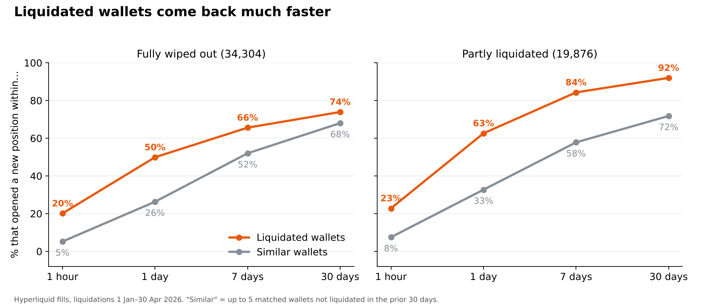
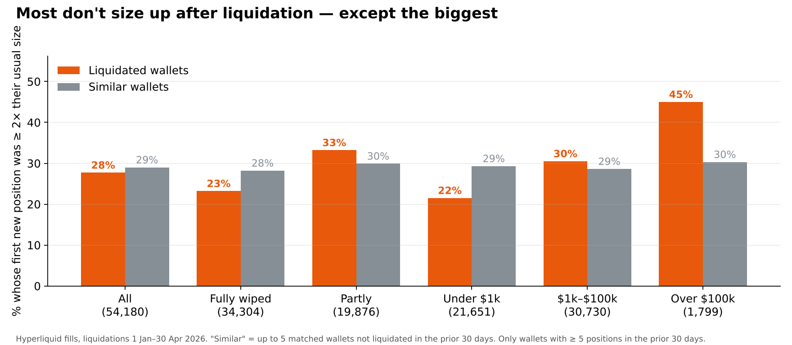
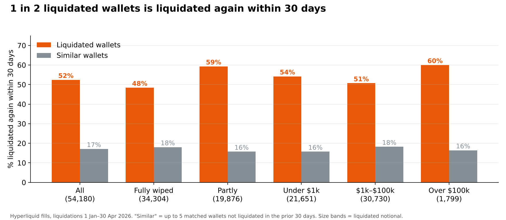

# Life After Liquidation

**What do Hyperliquid wallets do in the 30 days after they get liquidated?**

We followed 54,180 wallets liquidated on Hyperliquid between 1 Jan and 30 Apr 2026. We compared each one with up to 5 similar wallets that were not liquidated: 270,634 comparison wallets in all. This is a descriptive study of behaviour. It is not a trading strategy.

## Key findings

1. **1 in 2 is liquidated again within 30 days.** 52.4% of liquidated wallets are liquidated again within 30 days, against 17.1% of similar wallets. The gap shows up in every group we looked at: fully wiped or partly liquidated, small or large. It is fast, too: 13% are liquidated again within 24 hours, against 1.6% of similar wallets.\*
2. **They come back fast.** 55% open a new position within a day, against 29% of similar wallets. Among wallets that come back, the median wait is about 7 hours, against about 40 hours.
3. **Most don't size up.** Their first new position is 2× their usual size or more about as often as for similar wallets (28% vs 29%). Fully wiped wallets size up *less* (23% vs 28%). The exception is the largest liquidations, over $100k: 45% vs 30%.
4. **When they go back to the same coin, they bet the same way.** 80% of same-coin re-entries are on the same side (long or short) as the position that was just liquidated. For fully wiped wallets it is 78%.\* Going back to the same coin is mostly habit, though. These wallets already traded those coins a lot: 46% of their positions in the prior 30 days, against 17% for similar wallets. Beyond that habit, they go back to the coin about 9 points more often than expected; similar wallets show no such jump.\*
5. **Fully wiped wallets don't quit more often.** 26% have no fills in the next 30 days, against 28% of similar wallets.
6. **Liquidations on BTC/ETH repeat more.** 60% vs 16% are liquidated again within 30 days, against 49% vs 18% for altcoin liquidations.\* Market-wide liquidation days made no difference: behaviour after heavy-liquidation days matched normal days.\*

\*Extra checks added after the main results, at reviewers' suggestion. The rules were written before the code ran, but these were not part of the original plan. See "Extra checks" below.

## Full results (all events)

| Measure | Liquidated | Similar | Difference [95% CI] |
|---|---|---|---|
| New position within 1 hour | 21.1% | 6.1% | +15.0 [14.1, 16.0] |
| New position within 1 day | 54.6% | 28.6% | +26.0 [24.0, 27.9] |
| New position within 7 days | 72.4% | 54.1% | +18.3 [15.8, 20.9] |
| New position within 30 days | 80.5% | 69.4% | +11.1 [8.2, 13.9] |
| Liquidated again within 7 days | 35.2% | 7.0% | +28.2 [25.7, 30.5] |
| Liquidated again within 30 days | 52.4% | 17.1% | +35.3 [32.5, 38.1] |
| No fills for 30 days | 17.8% | 26.6% | −8.8 [−11.5, −5.8] |
| First new position ≥ 2× usual size* | 27.7% | 29.0% | −1.3 [−2.1, −0.5] |
| First new position on the same coin | 55.0% | 16.8% | +38.2 [37.1, 39.2] |

\*Only wallets with at least 5 new positions in the prior 30 days (n = 36,471).

The 95% intervals come from 2,000 bootstrap draws of whole event days, keeping each event with its comparison wallets. Splits by wiped vs partial, size band and liquidation method are in `step4_report.txt`.

## Extra checks (exploratory)

These were added after the main results, at reviewers' suggestion. Their rules were written before the code ran, and they used only data already built for the main study. All five of their own sanity checks passed.

| Check | Liquidated | Similar | Difference [95% CI] |
|---|---|---|---|
| Liquidated again within 24 hours | 13.1% | 1.6% | +11.4 [9.9, 13.0] |
| Median wait to repeat liquidation (among those liquidated again) | 90 h | 230 h | — |
| Same-coin re-entry on the same side as the liquidated position | 80.0% | n/a | — |
| Prior 30-day share of positions on the liquidated coins (habit) | 46.2% | 17.1% | +29.1 [28.0, 30.1] |
| Same-coin re-entry minus own habit | +8.8 pts | −0.2 pts | +9.1 [8.1, 10.0] |
| Liquidated again within 30 days, BTC/ETH-only liquidations | 59.8% | 15.5% | +44.4 [42.1, 46.8] |
| Liquidated again within 30 days, alts-only liquidations | 48.5% | 18.0% | +30.5 [26.4, 34.5] |
| Liquidated again within 30 days, heavy market-liquidation days | 52.2% | 17.5% | +34.7 [30.3, 39.0] |
| Liquidated again within 30 days, normal days | 52.6% | 16.7% | +35.9 [32.3, 39.5] |

Same-side re-entry has no comparison group, because similar wallets had no liquidated position. For partly liquidated wallets (84.5% same side), adding to the remaining position counts as same side by construction. Full output is in `step4x_report.txt`.

## How it was done

- **Data:** all Hyperliquid perp fills from 1 Dec 2025 to 31 May 2026 (about 290 coins). Vaults are removed, and so are market makers (maker share ≥ 70%).
- **Event:** a wallet's first liquidation episode between 1 Jan and 30 Apr 2026. The wallet must have traded on at least 3 days in the prior 30 days, with no other liquidation in those 30 days. At most one event per wallet.
- **Fully wiped vs partly liquidated:** every position was rebuilt from Hyperliquid's own `start_position`. "Fully wiped" means every coin the wallet held was flat after the episode.
- **Similar wallets:** matched on the 30 days before the event: trading days, notional band, BTC/ETH vs alts, and median position size.
- **Pre-registration:** every rule was written to a rules log before the code that uses it ran, and nothing was changed after looking.
- **Checks, all passed before any result was read:**
  - 20 random events were recomputed from raw fills, and all matched.
  - Position continuity held on 99.3% of fill pairs.
  - The event count was unchanged between steps.

## Limits

- **Association, not cause.** We can't see leverage or account equity, and the comparison wallets are not matched on leverage. So the higher repeat-liquidation rate may reflect a high-leverage trading style rather than the liquidation itself.
- **Partly liquidated wallets** still hold a position. Some of their "coming back" and staying active is mechanical, which is why the wiped and partial results are shown separately.
- **Wallets, not people.** One person can use many wallets. A wallet that "went quiet" may have moved to a new one.
- **Perp fills only.** We don't see deposits, withdrawals or spot trades.
- **Scope.** One exchange and four months; results may not hold elsewhere.
- **Small group.** Only 242 events involved the backstop liquidation method, so those numbers are rough.
