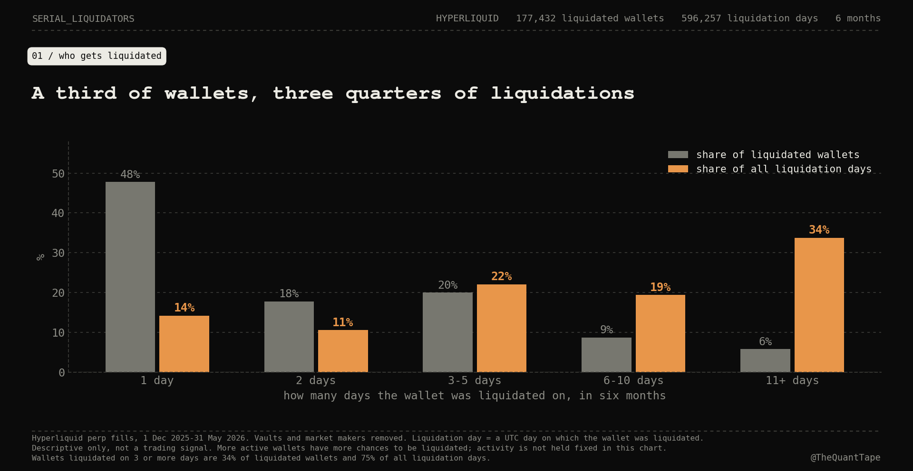
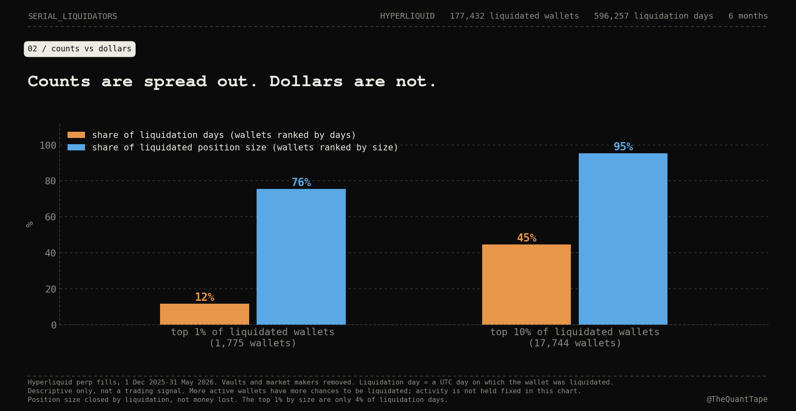
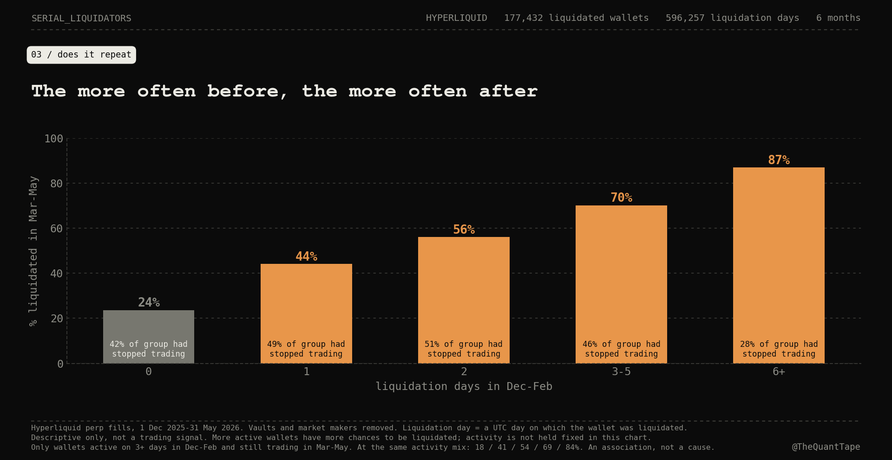

# Serial Liquidators

**How concentrated are liquidations on Hyperliquid? Do a few wallets account for most of them?**

We counted every liquidation on Hyperliquid perps from 1 Dec 2025 to 31 May 2026: 177,432 wallets liquidated at least once, on 596,257 wallet-days. This is a descriptive study. It is not a trading strategy, and it shows how liquidations are spread across wallets, not why.

A "liquidation day" is a UTC day on which a wallet has at least one liquidation fill. We count days, not single fills, so that one bad day split into many fills does not look like many liquidations.

## Key findings

1. **About half are liquidated once. The other half account for most liquidations.** 47.8% of liquidated wallets were liquidated on one day only. Wallets liquidated on 3 or more days are 34.5% of liquidated wallets and account for 75.2% of all liquidation days.
2. **A small group is liquidated again and again.** 5.8% of liquidated wallets were liquidated on 11 or more days in six months, and they account for a third of all liquidation days (33.8%).
3. **Dollars are far more concentrated than counts.** Ranked by size, the top 1% of liquidated wallets (1,775 wallets) account for 75.6% of all liquidated position size, and the top 10% for 95.3%. Those top-1% wallets are only 3.8% of liquidation days. Most liquidations are small: the typical liquidation day closes about $400 to $900 of position.
4. **Being liquidated is common among active wallets.** Of wallets that traded on 3 or more days in the six months, 43.2% were liquidated at least once. Of wallets that traded on 30 or more days, 60.1%.
5. **It tends to repeat.** Among wallets still trading in Mar–May, the share liquidated in Mar–May rises with how often they were liquidated in Dec–Feb: 23.7% for none, 44.2% for one day, 56.1% for two, 70.2% for three to five, and 86.9% for six or more. The same rise shows among wallets with similar activity.\*
6. **The next one is often close.** A liquidation day is followed by another for the same wallet within 7 days about half the time (49.8%), and within 1 day 19.8% of the time.

\*Extra check added after the main results. See "Extra check" below.

**How to read this.** Finding 5 is an association. The extra check shows it is not just a matter of how much a wallet trades. But leverage and position sizing are not observed, and wallets that run more risk will be liquidated more in both halves. Past liquidations mark out such wallets; nothing here shows that one liquidation leads to the next.

## Full results

Vaults and market makers are removed. Market makers are 4,065 liquidated wallets, 2.1% of liquidation days and 3.4% of liquidated position size.

**How many times** (177,432 liquidated wallets)

| Liquidation days in six months | Share of wallets | Share of all liquidation days | Typical position closed per liquidation day |
|---|---|---|---|
| 1 | 47.8% | 14.2% | $422 |
| 2 | 17.8% | 10.6% | $438 |
| 3–5 | 20.0% | 22.1% | $487 |
| 6–10 | 8.7% | 19.4% | $612 |
| 11+ | 5.8% | 33.8% | $932 |

Median 2 days, 90th percentile 7, 99th percentile 26.

**Concentration**

| Group | Share of wallets | Share of liquidation days | Share of liquidated position size |
|---|---|---|---|
| 3 or more liquidation days | 34.5% | 75.2% | 76.8% |
| 5 or more | 18.6% | 59.2% | 65.0% |
| 10 or more | 6.7% | 36.7% | 45.3% |
| Top 1%, ranked by days | 1.0% | 11.7% | 15.2% |
| Top 10%, ranked by days | 10.0% | 44.7% | 56.2% |
| Top 1%, ranked by size | 1.0% | 3.8% | 75.6% |
| Top 10%, ranked by size | 10.0% | 26.0% | 95.3% |

All shares are of liquidated wallets, not of all Hyperliquid wallets. "Position size" is the size of positions closed by liquidation (size × price). It is not the money lost. Gini coefficient: 0.54 for liquidation days, 0.96 for position size.

**Other ways of counting.** Two liquidation days in a row may be one event that ran past midnight. Counting each run of back-to-back days as one "spell": 51.7% of wallets have one spell, and wallets with 3 or more spells are 29.9% of wallets and 67.2% of spells. Counting clusters of fills less than 60 minutes apart instead: wallets with 3 or more clusters are 37.1% of wallets and 79.6% of clusters (80.1% with a 30-minute gap, 78.9% with 120 minutes).

**Base rate** (share liquidated at least once)

| Days the wallet traded on, in six months | Wallets | Liquidated at least once |
|---|---|---|
| 1–2 | 320,472 | 8.8% |
| 3–9 | 168,660 | 33.2% |
| 10–29 | 106,332 | 47.6% |
| 30+ | 70,965 | 60.1% |
| 3 or more | 345,957 | 43.2% |
| Any | 666,429 | 26.6% |

**Repeat across halves.** Wallets that traded on 3 or more days in Dec–Feb, grouped by their Dec–Feb liquidation days.

| Liquidation days in Dec–Feb | Wallets | Stopped trading by Mar–May | Liquidated in Mar–May, of those still trading [95% CI] | Liquidated in Mar–May, of all |
|---|---|---|---|---|
| 0 | 118,594 | 42.0% | 23.7% [23.4, 24.0] | 14.0% |
| 1 | 31,567 | 48.7% | 44.2% [43.4, 45.0] | 23.6% |
| 2 | 18,077 | 51.1% | 56.1% [55.1, 57.2] | 28.2% |
| 3–5 | 20,736 | 45.9% | 70.2% [69.3, 71.0] | 38.7% |
| 6+ | 12,707 | 28.4% | 86.9% [86.2, 87.6] | 62.9% |

"Stopped trading" means no fill other than a liquidation in Mar–May. Of all liquidated wallets, 17.2% have liquidation days in both halves. Intervals come from 2,000 bootstrap draws of wallets.

**Spacing.** After a liquidation day, the same wallet has another within 1 day 19.8% of the time, within 7 days 49.8%, and within 30 days 66.0%. Between consecutive liquidation days the gap is 4 days at the median (quartiles 1 and 10), cut short by the six-month window.

**Splits fixed in advance** (share of liquidated wallets with 3 or more liquidation days)

| Split | Wallets | 3 or more liquidation days |
|---|---|---|
| Traded under $100k in six months | 119,190 | 27.0% |
| Traded $100k–$10M | 52,952 | 48.9% |
| Traded over $10M | 5,290 | 59.0% |
| Liquidated on BTC/ETH only | 46,088 | 21.0% |
| Liquidated on other coins too | 131,344 | 39.2% |
| First seen in Dec 2025 | 64,301 | 43.4% |
| First seen later | 113,131 | 29.4% |

Wallets seen from the start had more time to be liquidated, so the last two rows are not a like-for-like comparison. The full output is in `sl_report.txt`.

## Extra check (exploratory)

Added after the main results, because every reviewer raised the same doubt: wallets that trade more have more chances to be liquidated, so the repeat pattern might only reflect activity. Its rules, including how the answer would be read, were written to the rules log before it ran.

Wallets were put into cells by how many days they traded in Dec–Feb (3–9, 10–29, 30+), how many days they traded in Mar–May (1–9, 10–29, 30+) and how much they traded in Dec–Feb (under $100k, $100k–$10M, over $10M). The repeat rate was computed inside each cell and averaged with the same weights for every group, so all five groups are compared at the same mix of activity. 17 of the 27 cells had enough wallets in every group; they cover 83.8% of the population.

| Liquidation days in Dec–Feb | Liquidated in Mar–May, raw | At the same activity mix [95% CI] |
|---|---|---|
| 0 | 23.7% | 18.2% [17.9, 18.5] |
| 1 | 44.2% | 41.4% [40.6, 42.2] |
| 2 | 56.1% | 54.4% [53.3, 55.5] |
| 3–5 | 70.2% | 69.5% [68.6, 70.4] |
| 6+ | 86.9% | 84.4% [81.7, 86.8] |

The gap between the top and bottom group is 66 points [63, 69] at the same activity mix, against 63 raw. The rise also shows inside every single band. For example, among wallets that traded on 30 or more days in both halves and traded $100k–$10M: 25%, 54%, 64%, 79% and 95%.

Activity does matter on its own: among wallets with no liquidation in Dec–Feb, 12% of those trading on 1–9 days in Mar–May were liquidated, against 40% of those trading on 30 or more. It just does not explain the difference between the groups.

The same check for "how many times": among liquidated wallets that traded on 30 or more days, 29.3% were liquidated on one day only and 20.6% on 11 or more. Full output is in `slx_report.txt`.

## How it was done

- **Data:** every liquidation fill on Hyperliquid perps from 1 Dec 2025 to 31 May 2026 (2,161,385 fills), and a table of each wallet's fills per day. Both were built for [Life After Liquidation](../life-after-liquidation/) and reused read-only.
- **Removed:** vaults, and market makers (wallets with 70% or more of their volume as maker).
- **Pre-registration:** the plan was reviewed, changed and frozen in a rules log before any code was written. The run was done once, and its results were opened only after all checks had passed.
- **Checks, all passed before any result was read:**
  - Fill and cluster totals match the earlier study exactly (2,161,385 and 710,878).
  - The per-day table and the fill table agree on the number of liquidation fills.
  - Market-maker flags agree with the earlier study for every wallet.
  - Shares add up to 100%.
  - 20 random wallets were recounted one by one from raw fills, and all matched.

## Limits

- **Exposure.** A wallet that trades more, larger or with more leverage has more chances to be liquidated. The main tables do not hold activity fixed. The extra check does, for the repeat pattern only, and only for trading days and volume: leverage and position size against the account are not in the data.
- **Association, not cause.** Leverage, position size and coin choice differ between wallets and are not observed. Past liquidations mark out wallets at risk; they are not shown to cause later ones.
- **Still trading.** The repeat rates are for wallets still trading in Mar–May. Between 28% and 51% of each group had stopped, and a wallet that stops cannot be liquidated again.
- **Position size is not loss.** We do not see margin, account size or money lost.
- **Partial liquidations count.** A wallet that loses part of a position on a day counts the same as one that is fully wiped.
- **Liquidated wallets only.** Every "top 1%" here is of liquidated wallets, not of all wallets on Hyperliquid.
- **Wallets, not people.** One trader can use several wallets, and bots are only partly filtered.
- **Scope.** One exchange and six months; results may not hold elsewhere.

Prior work: [Life After Liquidation](../life-after-liquidation/) followed wallets for 30 days after their first liquidation. This study counts all liquidations of all wallets over the whole period. Other work on Hyperliquid liquidations that we found looks at cascades and market-wide totals, for example [Garcia Seuma (2026)](https://arxiv.org/abs/2608.03616) on the October 2025 cascade, not at how liquidations are spread across wallets. We did not find a published wallet-level count of this kind, after a limited search.
