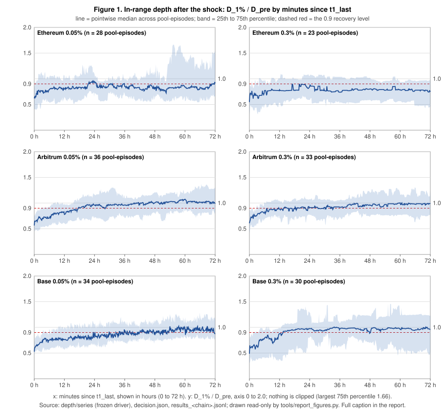
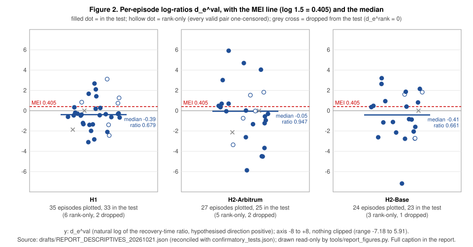

# How fast does in-range liquidity recover after large ETH/USDC moves? A preregistered Uniswap v3 pilot

**Version 1.0 — public release. Identical in content to reviewed draft v0.5 (sha256 `5d7be036…ebdb`) except for status lines, plus one corrected short hash.** v0.5 applies the second independent review of v0.4 (eleven items, listed in Appendix I); v0.4 is kept unchanged. No pipeline run, no data or frozen file changed, no verdict changed.

Every number carries a source tag in square brackets; the key is Appendix H. "Derived" marks a count the drafter took from a record file; "descriptive, not pre-registered" marks a quantity the prereg did not name.

---

## 0. Header

| Item | Value | Source |
|---|---|---|
| The one look | `pipeline.run_analysis`, once, 2026-10-20 16:50:37–16:50:51 UTC, exit 0, 14.2 s, peak 84.4 MB | [AR] |
| Preregistration | v0.3, frozen 2026-10-17; sha256 `8d4b9bfc502c0baccb99fafa4d070d7446bd944e7c975ade5a596f0ff19a9a16` | [RL 2026-10-17] |
| Outage list (S4) | sha256 `2f6115aa761b4643118442d019db1c922c2541e1d8d10c5af325501366c9d5e4` | same |
| Code freeze | 35 files hashed 2026-10-17T08:13:39 UTC; `CODE_FREEZE_MANIFEST.md` sha256 `ff3f0893554002ae5feed9a3affe6c2da960e945065e09e4e5f1f7c3a2506b4b` | [CFM] |
| Repository | https://github.com/viter999/uniswap-liquidity-recovery — commits `71ed3db8…3647` (prereg copy, outage list, manifest) and `23b95786…7490` (frozen code, tests, lock file) | [RL 2026-10-17] |
| Reproduction release | **Published** in `github.com/viter999/uniswap-liquidity-recovery`; contents in §7 and Appendix G.3 | this report |
| Dataset | Placeholder: release to be decided later (parquet + CSV, CC-BY-4.0 planned, §9) | [P §9] |

**One-sentence answers** (pre-declared verdict words only; each test is two-sided at α = 0.05 with a directional requirement, so effectively one-sided at α = 0.025 [P §7.6]):

- **H1 (fee tier): No.** The 0.05% pool did not recover at least 1.5× faster than the 0.3% pool on the same chain: n = 33, median ratio 0.679, 90% CI [0.533, 0.825], p = 0.304 [CT].
- **H2-Arbitrum (chain): No.** The Arbitrum pool did not recover at least 1.5× faster than the Ethereum pool of the same tier: n = 25, median ratio 0.947, 90% CI [0.388, 1.414], p = 0.381, Holm p = 0.762 [CT].
- **H2-Base (chain): Null.** Inconclusive: n = 23, median ratio 0.661, 90% CI [0.253, 1.906], p = 0.560, Holm p = 0.762 [CT].

No test was Underpowered (all n ≥ 20); these are the only three p-values in this report (§7.7).

---

## 1. Question and why it matters

After a large, fast move in the ETH/USDC price, how quickly does the liquidity near the current price (in-range depth) return to its pre-shock level in Uniswap v3 pools, and does that speed differ by fee tier (0.05% vs 0.3%, H1) and by chain (Ethereum vs Arbitrum vs Base, H2)? [P §1]

**In-range depth is what a taker gets.** The pilot measures D_Z(m) = D_sell + p(m)·D_buy: the USD obtainable selling ETH until the price falls by Z plus the USD value of the ETH obtainable buying until it rises by Z, at Z = 1%, fee-free, USDC at 1 USD [P §6.2]. **Resiliency**, as in the order-book literature, is the time after the last trigger until D_Z stays at or above 90% of its pre-shock median for 15 consecutive minutes [P §6.3].

**Why tier and chain could matter.** LPs may sort by size and sophistication across tiers; repositioning is cheaper on L2s; the UNIfication fee switch takes a larger protocol share from the 0.05% tier (25%) than from the 0.3% tier (≈ 16.7%) after 2025-12-28 (as frozen in the prereg with `[VERIFY]` marks, not re-verified) [P §10.2]. The hypothesised directions were fixed before the data: 0.05% faster than 0.3%; L2 faster than Ethereum [P §7.2, §7.3]. No public work had defined a shock event on Uniswap pools and measured the time-to-recover of in-range depth across tiers and chains [P §2].

---

## 2. Preregistered design

| Element | Rule (frozen v0.3) | Source |
|---|---|---|
| Pools | Confirmatory: Ethereum 0.05% (episode clock) and 0.3%; Arbitrum 0.05%, 0.3%; Base 0.05%, 0.3%. Exploratory: Unichain v3 0.3%. Base's TVL order is inverted on the 17 Oct 2026 snapshot (0.3% ≈ $146M vs 0.05% ≈ $9M) while the measured in-range depth runs the other way (median D_pre $775,694 vs $280,143, Appendix F.5). Addresses in Appendix E | [P §3] |
| Windows | Confirmatory W = [2024-01-01, 2026-10-01) UTC by t1_first; calibration 2023 Ethereum only | [P §4] |
| Shock and episodes | Trigger on the clock pool's per-minute price when \|log(p(m)/p(m − L))\| ≥ θ, primary (0.05, 60 min); triggers < 48 h apart chain; t0 = t1_first − L; span > 48 h → `long_cluster`; non-clock pools join only with `local_shock` (own move ≥ 0.8·θ, same sign) | [P §5.1–§5.5] |
| Threshold decision | After the code freeze, before any depth data: switch to (0.03, 30) iff N_conf(primary) < 24. **Result: N = 48, N_conf = 41; primary set kept** (alternate: 104 / 88) | [P §5.6]; [DJ] |
| Metric | Pre-shock [t0 − 180, t0 − 15]; dip window [t0, t1_last + 30]; `dip` iff min D_Z < 0.75·D_pre; T_rec = first minute ≥ t1_last with D_Z ≥ 0.9·D_pre for 15 min, censored at 4,320 min; ratios use T_rec + 1 | [P §5.3, §5.4, §6.3] |
| Reconstruction and checks | R2 snapshot route with band re-reads; R1 full replay as cross-check on Ethereum and Arbitrum; stage A on 2023 Ethereum; stage B on the pull; no T_rec before stage B passes | [P §6.1] |
| Pairs and test | Valid pair: both members `dip`, `local_shock`, not `outage`, `band_read_failed`, `pool_absent`, not both censored. One value per episode: H1 r = log((T_rec(0.3%)+1)/(T_rec(0.05%)+1)) per chain; H2 r = log((T_rec(Ethereum)+1)/(T_rec(L2)+1)) per tier; d_e^val → M = exp(median) and bootstrap CI (B = 10,000, seed 20261017); d_e^rank → Wilcoxon signed-rank, two-sided | [P §7.1–§7.5] |
| Verdicts and families | Underpowered if n < 20. Yes: p < 0.05 (Holm for H2) and M ≥ 1.5. No: otherwise, if the 90% CI of M lies entirely below 1.5. Null: otherwise. Exactly three confirmatory p-values; §7.8 reported without p-values or verdicts | [P §7.6, §7.7] |
| Changed after the freeze | **No analysis parameter changed; these procedures changed:** data routes, timestamp sources, creation-block source, pre-freeze reconstruction code, process control, freeze scope, reporting tools; four pre-registered steps not done or from a different source — Appendix C | [RL] |

---

## 3. Data and checks

**Routes and provenance.** Ethereum: `rpc.mevblocker.io`; timestamps from the `blockTimestamp` log field cross-checked against headers (D9): 39,447 clock-series and 19,802 depth-window blocks, 0 mismatches [RP; RES-ethereum derived]. Arbitrum: all 96 windows are Tenderly log-field windows (D14) cross-checked against official headers on 60,663 blocks, 0 mismatches, none from the headers route; `eth_call` on Tenderly (D19); lifetime Mint/Burn from the official endpoint (D21) [RL 2026-10-19]. Base: the Tenderly gateway (D18) after drpc measured safe only at 0.5 req/s and Blockscout answered a browser challenge. **No fallback was configured for any chain** (`fallback_logs_api: null`); drpc served only as the completeness second source on Base, departing from the 17 Oct ruling that named drpc at 0.5 req/s as the fallback [RL 2026-10-17 08:24]. Base and Unichain timestamps by the verified OP-stack formula, 50 random blocks per chain re-checked in both phases, 0 mismatches [RP; CK-*]. No duplicate log on any chain [RD]. Completeness samples: 0 mismatches, second sources differing from the prereg's on Arbitrum and Base (Appendix C). Details: Appendix G.1.

**The Base pull** ran 2026-10-17 20:04 to 2026-10-19 02:43 UTC in six driver attempts under the process supervisor, with 134 starts refused by the memory gate, 30 Tenderly rate-limit retries and 4 give-ups (attempt table in Appendix G.1) [LOG-base]. The Base pull record's figures (1,358 requests, 0 retries, 0 rate-limit hits, 0 fallbacks, 0 pauses) are the final attempt's per-process counters only [PR-base].

**Stage A (2023 Ethereum): PASS** — 2,039,803 swaps, 0 mismatches; R1/R2 identical on 10 of 10 pool-windows; fixes D1 and D6 [RL 2026-10-17]. **Stage B (confirmatory): PASS on all four chains** [CK-*]: Ethereum R1 1,521,493 swaps and Arbitrum R1 9,800,131 swaps, 0 failures; R1/R2 identical on the five drawn episodes (the pre-registered check) and in fact on all 96 Ethereum and all 96 Arbitrum pool-episodes, maximum relative difference 0.0. **Base (D8): no R1 route; the equality is checked on the snapshot route for in-band swaps only — 7,089,104 checked, 58 unchecked (same-block band exits), 0 mismatches; the R1/R2 check is not applicable on Base** (Appendix B). Unichain 167,451 checked, 0 unchecked. Lifetime coverage for R1: PASS [CV-*].

**Episodes.** 48 episodes, 288 confirmatory pool-episodes [DJ; CT]: 2024: 17, 2025: 24, 2026: 7; ETH_down 32, ETH_up 16; `long_cluster` 3; `truncated_by_next` 4; `pre_in_prior_recovery` 4; incentive and fee-switch flags 13 / 10 / 7 / 2 (windows as frozen, not re-verified; Appendices A, E). **Outage: one episode, 46 (2026-06-25), on both Base pools** [RES-base; OL]. `chain_degraded`: episode 42 on Base. No header gap [CK-*].

---

## 4. Results

**Table 1 — per pool** (n and shares derived from [RES-chain]; median T_rec and CI are the resilience scores of the one run [CT]).

| Pool | Pool-episodes ok | `local_shock` | `dip` among local (share) | n for the score | Median T_rec, min (90% CI) | Censored (share of n) | Median T_50, min (derived) |
|---|---|---|---|---|---|---|---|
| Ethereum 0.05% (clock) | 48 | 48 | 28 (58%) | 28 | 324.5 (159.5–807.0) | 5 (18%) | 66 |
| Ethereum 0.3% | 48 | 47 | 23 (49%) | 23 | 1,000.0 (74.0–4,320.0) | 9 (39%) | 32 |
| Arbitrum 0.05% | 48 | 46 | 36 (78%) | 36 | 936.0 (281.0–1,384.0) | 8 (22%) | 137 |
| Arbitrum 0.3% | 48 | 46 | 33 (72%) | 33 | 376.0 (242.0–1,085.0) | 4 (12%) | 106 |
| Base 0.05% | 47 (1 outage) | 43 | 34 (79%) | 34 | 1,615.5 (791.0–2,334.0) | 6 (18%) | 134 |
| Base 0.3% | 47 (1 outage) | 40 | 30 (75%) | 30 | 458.0 (162.0–739.0) | 4 (13%) | 69 |
| Unichain 0.3% (exploratory) | 28 (20 `pool_absent`) | 23 | 13 (57%) | — (§5) | — | 2 of 13 | 40 |

T_50 medians skip pool-episodes with no T_50 (half-recovery never reached): 1 / 4 / 2 / 0 / 0 / 2 for the six confirmatory pools in table order, 2 for Unichain [RES-* derived].

**Table 2 — the three confirmatory tests** [CT]; counts, zeros dropped and the observed SD in Table 2b (Appendix F.0).

| Test | n | p | Holm p | Median ratio M | 90% CI | Verdict |
|---|---|---|---|---|---|---|
| H1 | 33 | 0.304 | 0.304 | 0.679 | [0.533, 0.825] | **No** |
| H2-Arbitrum | 25 | 0.381 | 0.762 | 0.947 | [0.388, 1.414] | **No** |
| H2-Base | 23 | 0.560 | 0.762 | 0.661 | [0.253, 1.906] | **Null** |

Definition: M = exp(median d_e^val); M < 1 means the numerator pool (0.3% for H1; Ethereum for H2) had the shorter recovery time on the median episode. "No" requires only that the 90% CI lies entirely below the MEI 1.5 [P §7.6]; its meaning is in §6.

**Figure 1 — depth-recovery curves.** D_1% / D_pre against minutes since t1_last (0 to 72 h), one panel per confirmatory pool. Line: pointwise median across the pool-episodes that enter pairs (n as in Table 1); band: their 25th to 75th percentile; dashed red: the 0.9 recovery level. The y-axis runs to 2.0; nothing is clipped (largest 75th percentile 1.66, Ethereum 0.05% at minute 3,320, about 55 h) [FG; Appendix F.8]. *A median curve can stay below 0.9 although the pool's median T_rec is finite:* T_rec is an episode-level event reached at different minutes by different episodes, which may fall back afterwards, while the curve is the median across episodes at each minute, so at no single minute need half the episodes be above 0.9 (Ethereum 0.3%: median T_rec 1,000 min, median curve at 0.75–0.85 for most of the window).

**Figure 2 — per-episode log-ratios.** Each dot is one episode's d_e^val: for H1 the mean over its valid chains of log((T_rec(0.3%) + 1) / (T_rec(0.05%) + 1)); for H2 the mean over its valid tiers of log((T_rec(Ethereum) + 1) / (T_rec(L2) + 1)). Positive values are the hypothesised direction; censored members enter at their censored value; dashed red: the MEI (log 1.5 = 0.405); blue bar: the median of the plotted values (log M: −0.39, −0.05, −0.41); horizontal spread is jitter. *Counts:* the panels show every episode with at least one valid pair (35 / 27 / 24); the test uses n = 33 / 25 / 23 because §7.4 drops episodes whose rank statistic d_e^rank is exactly 0 (grey crosses): episode 20 in all three tests (identical recovery times in every valid pair), episode 45 in H1 and episode 12 in H2-Arbitrum (the mean over their uncensored pairs is exactly 0 while a one-censored pair pulls d_e^val away from 0). Hollow dots are rank-only episodes (every valid pair one-censored: 6 / 5 / 3), entering the test at ±(max |d_e^rank| + 1). Nothing is clipped [RD; FG].

---

## 5. Sensitivity and exploratory (pre-declared; no p-values, no verdicts)

Under §7.7 exactly three confirmatory p-values exist (Table 2); everything in §7.8 is reported without p-values and without verdicts: n and the median ratio with its 90% bootstrap CI only [SE; P §7.7, §7.8].

| Analysis | H1: n, M (90% CI) | H2-Arbitrum | H2-Base |
|---|---|---|---|
| Primary [CT] | 33, 0.679 (0.533–0.825) | 25, 0.947 (0.388–1.414) | 23, 0.661 (0.253–1.906) |
| S-a exclude `incentive_v4_pull`, `structural_fee_switch` | 21, 0.694 (0.404–0.874) | 16, 0.834 (0.265–1.013) | 15, 0.427 (0.161–1.916) |
| S-b S-a + Arbitrum `incentive_possible` pairs removed | 18, 0.679 (0.360–0.764) | 7, 0.960 (0.169–1.006) | (not run by design) |
| S-c `dip = false` enter with T_rec = 0 | 39, 0.725 (0.616–1.000) | 37, 0.397 (0.086–0.986) | 38, 0.577 (0.254–1.000) |
| S-d sign of d_e^val, positive / negative (zeros dropped) [CT] | 11 / 23 | 11 / 15 | 11 / 12 |
| S-e exclude `long_cluster`, `pre_in_prior_recovery` | 29, 0.709 (0.548–0.825) | 22, 0.960 (0.430–1.414) | 19, 0.661 (0.315–2.253) |
| S-f H1 without Ethereum | 33, 0.533 (0.267–0.825) | — | — |
| S-g H1 without Base | 31, 0.835 (0.510–1.433) | — | — |
| S-h Z = 0.5% | 34, 0.762 (0.460–1.272) | 26, 0.633 (0.263–1.217) | 22, 0.663 (0.218–1.301) |
| S-h Z = 2% | 34, 0.650 (0.541–0.839) | 23, 0.928 (0.418–1.052) | 22, 0.436 (0.307–1.788) |
| S-i alternate set (0.03, 30 min) | Not computed: 104 episodes detected, no depth pulled (G12) [DJ] | | |
| S-j stratified statistic (H1) | T = −4.469 (strata n: Ethereum 15, Arbitrum 31, Base 24); reported as a statistic only | — | — |

**No sensitivity moves a point estimate across the MEI:** every median ratio is below 1.5 (largest 0.960 for H2-Arbitrum under S-b and S-e; 0.835 for H1 under S-g).

**Pre-declared descriptives** (read-only reconstruction with the §7.1a pair rules; Appendix F [RD]). Per-chain H1 pair medians: Ethereum 1.875 (17 pairs), Arbitrum 0.562 (33), Base 0.700 (26). Per-tier H2: on both L2s the 0.3%-tier pairs sit above 1 (1.957, 4.000) and the 0.05%-tier pairs below (0.755, 0.201). The ETH_up and post-fee-switch groups hold 2–8 episodes and are not readable. In every confirmatory pool the deeper half of pre-shock states took longer to return to 90% of D_pre; this half-split is descriptive, not pre-registered, its medians include censored values, and each half holds about 12–18 pool-episodes. Replenishment share: not computed (N16).

**Unichain v3 0.3% (exploratory) — known limitation.** The run reports n = 0 for this pool because the runner used its default chain list [CT]; the gap stays by the operator's decision. From the depth records (derived, exploratory): 20 `pool_absent`, 28 ok, 13 with `dip` and `local_shock`, median T_rec 1,019 min, 2 censored [RES-unichain].

---

## 6. Interpretation and limits

**What the verdicts license.** For H1 and H2-Arbitrum the answer is **No**: the 90% bootstrap CI of the median ratio lies entirely below 1.5. "No" means the interval rules out a 1.5× effect in the hypothesised direction, not "no difference"; H2-Arbitrum's interval reaches 1.41. For H2-Base it is **Null**. The H1 interval also lies below 1. That direction was not pre-registered and has no test here, so it is not a finding. It is not consistent across chains either: Ethereum pairs go the other way (1.875). Each test is two-sided at α = 0.05 with a directional requirement, so **effectively one-sided at α = 0.025** [P §7.6].

**Power.** The prereg's note: 20 episodes give ≈ 80% power for a true median log-ratio of log 1.5 only if the SD of d_e is ≈ 0.6, ≈ 50% at 0.9 [P §7.6]. The observed SD of d_e^val is 1.456 (H1), 2.794 (H2-Arbitrum), 2.323 (H2-Base) [RD], far above both. The prereg's own approximation at these SDs and n gives about 35%, 11% and 13% power before Holm — **rough, descriptive, not pre-registered** (a hand normal approximation). The verdicts rest on the bootstrap CIs, not on power.

**Known confounds not removable by design.** *Base size inversion:* on the TVL snapshot of 17 Oct 2026 the Base 0.3% pool held ≈ $146M against ≈ $9M in the 0.05% pool, but the in-range depth this study measures runs the other way (median pre-shock D_pre $775,694 in Base 0.05% vs $280,143 in Base 0.3%, Appendix F.5); S-g: M = 0.835, CI 0.510–1.433. *Clock-pool advantage* (S-f: M = 0.533, CI 0.267–0.825). *Incentive windows* (13 + 10 + 7 flagged episodes, as frozen and not re-verified; S-a and S-b leave every M at or below 0.96). *NFPM owner collapse* (replenishment share not computed). *Dip rate* (49–79% of confirmed pool-episodes dipped; 55 of 68 invalid H1 pairs are `dip`): S-c, which keeps them at T_rec = 0, moves the H1 ratio toward 1 (0.679 → 0.725) and only the two H2 ratios further below 1 (0.947 → 0.397 and 0.661 → 0.577); none crosses 1.5.

**Deviations and limitations stated plainly.**
- *Base checking (D8):* the Swap-liquidity equality runs on the full-replay route R1 for Ethereum and Arbitrum only; Base has no R1 route, so there it is checked on the snapshot route for in-band swaps only, and **58 of 7,089,162 Base window swaps were unchecked** (same-block band exits) over 12 pool-episodes (Appendix B). The five-episode R1/R2 check covers Ethereum and Arbitrum members only [CK-base].
- *Base outage:* **one episode, 46, unusable on both Base pools** (window overlapping the S4 halts O2 and O3 of 25–26 June 2026) [RES-base; OL].
- *Base pull:* six attempts with rate-limit give-ups and memory-gate pauses, no fallback configured (Appendix G.1); the records are the frozen driver's, but the pull was not one clean run.
- *Unichain:* the 0.05% pool was excluded at the freeze (≈ $14K); the 0.3% pool is exploratory, absent for episodes 1–20, and missing from the analysis run (§5).
- *Not done or from a different source:* the reorg re-check across the pull cutoffs (§8.4; cutoffs recorded in Appendix G.4), the Unichain analysis, the replenishment share, and the completeness second sources on Arbitrum and Base (Appendix C).
- *Reproduction:* needs the release listed in §7; until then only the frozen code is public.

**What would change the conclusion, and whether it happened.** Threshold switch (N_conf < 24): no (41). Stage A or B failure: none. Timestamp mismatch: none. Reorg across a cutoff: not checked. Prereg analysis parameter changed after the freeze: none (Appendix C).

---

## 7. Reproducibility

- **Preregistration:** private frozen v0.3; the public copy differs in exactly 4 redacted lines (`REDACTIONS.md`) [RL 2026-10-17].
- **Code and lock file:** repository above at commit `23b95786…7490`; `requirements.lock` = Python 3.9.7, numpy 2.0.2, scipy 1.13.1, pytest 8.4.2 (D11). Code MIT, documents CC-BY-4.0. Hash check: `python -I tools/freeze_hash.py --verify CODE_FREEZE_MANIFEST.md` → "verified 35 files, 0 problems".
- **Reproduction needs a further release, published in `github.com/viter999/uniswap-liquidity-recovery`:** the six wrappers, the six override files, a public deviations file (D1–D23), `decision.json`, the four `results_*.jsonl` and the four `checks_*.json` (the analysis runner refuses to run without them); list with sizes and sha256 in `drafts/release/RELEASE_LIST_v0.4.md` (published as `HASHES.txt` in `github.com/viter999/uniswap-liquidity-recovery`) (Appendix G.3), every file scanned for keys, tokens, private URLs, personal paths and e-mail addresses: none found.
- **Settings a reproduction must copy:** the price-only phase also ran through the route override (as in force at the GO, sha256 `d88316aa5b3b9a31355dc46990f5383c9cbd4b892efaddb1763198f89eb17933`); the Base depth pull needs the override (D18); the analysis runner uses its default chain list, which excludes Unichain. Full override hashes: Appendix G.3; both cutoff sets: Appendix G.4.
- **Exact commands, in the frozen order:** (1) `python -m pipeline.price_only --go`; (2) `tools/run_depth.py --chain <chain> --go` per chain, Arbitrum via the pre-fetch wrapper then the driver with the hb10 route file and driver creation override (Appendix G.5); (3) `tools/coverage_check.py --chain ethereum,arbitrum`; (4) `tools/run_analysis_guarded.py` with defaults.
- **Manifest hashes:** Appendix G.2. The analysis runner refuses unless every chain's stage B checks passed; with the same inputs and pinned scipy it is deterministic (bootstrap seed 20261017) [P §7.5]. **Dataset:** placeholder, release to be decided later.

---

## Appendix A — Episode list with flags (primary set; derived from [DJ], [RES-base] and the §10.2 windows)

Columns: episode; t1_first (UTC); t1_last; span (min); direction; largest 60-min |Δlog p|; non-clock confirmatory pools with `local_shock` (of 5); censor horizon (min); flags.

| ep | t1_first (UTC) | t1_last | span | dir | max abs dlog | local | censor | flags |
|---|---|---|---|---|---|---|---|---|
| 1 | 2024-01-03 12:07 | 01-03 12:46 | 39 | down | 0.078 | 5/5 | 4320 | incentive_possible(Arb) |
| 2 | 2024-01-23 09:29 | 01-23 09:29 | 0 | down | 0.054 | 1/5 | 4320 | incentive_possible(Arb) |
| 3 | 2024-02-28 18:15 | 02-28 18:28 | 13 | down | 0.069 | 5/5 | 4320 | incentive_possible(Arb) |
| 4 | 2024-03-05 19:38 | 03-06 05:37 | 599 | down | 0.086 | 4/5 | 4320 | incentive_possible(Arb) |
| 5 | 2024-03-15 03:28 | 03-15 09:11 | 343 | down | 0.056 | 5/5 | 4320 | incentive_possible(Arb) |
| 6 | 2024-03-20 16:31 | 03-20 16:31 | 0 | down | 0.054 | 4/5 | 4320 | incentive_possible(Arb) |
| 7 | 2024-04-12 18:36 | 04-13 23:19 | 1723 | down | 0.127 | 5/5 | 4320 | incentive_possible(Arb) |
| 8 | 2024-05-20 19:27 | 05-20 20:23 | 56 | up | 0.093 | 3/5 | 4307 | incentive_possible(Arb), truncated_by_next |
| 9 | 2024-05-23 21:10 | 05-23 21:12 | 2 | up | 0.056 | 5/5 | 4320 | incentive_possible(Arb), pre_in_prior_recovery |
| 10 | 2024-07-05 02:59 | 07-05 03:33 | 34 | down | 0.061 | 5/5 | 4320 | incentive_possible(Arb) |
| 11 | 2024-07-08 09:02 | 07-08 09:02 | 0 | up | 0.055 | 5/5 | 4320 | incentive_possible(Arb) |
| 12 | 2024-08-04 17:44 | 08-06 14:23 | 2679 | down | 0.243 | 5/5 | 4320 | incentive_possible(Arb) |
| 13 | 2024-08-27 21:48 | 08-27 22:15 | 27 | down | 0.062 | 5/5 | 4320 | incentive_possible(Arb) |
| 14 | 2024-11-06 03:06 | 11-06 03:08 | 2 | up | 0.058 | 5/5 | 4320 | - |
| 15 | 2024-11-21 12:42 | 11-21 12:51 | 9 | up | 0.054 | 5/5 | 4320 | - |
| 16 | 2024-12-09 21:04 | 12-09 21:05 | 1 | down | 0.059 | 4/5 | 4320 | - |
| 17 | 2024-12-19 20:12 | 12-19 20:12 | 0 | down | 0.053 | 5/5 | 4320 | - |
| 18 | 2025-01-07 15:42 | 01-07 15:45 | 3 | down | 0.054 | 5/5 | 4320 | - |
| 19 | 2025-01-19 14:15 | 01-19 21:47 | 452 | up | 0.057 | 5/5 | 4320 | - |
| 20 | 2025-02-03 01:48 | 02-04 05:45 | 1677 | down | 0.306 | 5/5 | 4320 | - |
| 21 | 2025-02-24 23:00 | 02-25 07:59 | 539 | down | 0.066 | 5/5 | 3902 | truncated_by_next |
| 22 | 2025-02-28 02:01 | 02-28 02:01 | 0 | down | 0.051 | 5/5 | 3698 | truncated_by_next, pre_in_prior_recovery |
| 23 | 2025-03-02 16:39 | 03-04 17:40 | 2941 | up | 0.105 | 5/5 | 4320 | long_cluster, pre_in_prior_recovery |
| 24 | 2025-03-10 14:18 | 03-11 01:51 | 693 | down | 0.078 | 5/5 | 4320 | - |
| 25 | 2025-04-06 18:21 | 04-10 15:51 | 5610 | down | 0.110 | 5/5 | 4320 | incentive_v4_pull, long_cluster |
| 26 | 2025-05-09 07:46 | 05-09 09:37 | 111 | up | 0.074 | 5/5 | 4320 | incentive_unichain, incentive_v4_pull |
| 27 | 2025-05-21 17:44 | 05-23 12:17 | 2553 | down | 0.057 | 5/5 | 4320 | incentive_unichain, incentive_v4_pull |
| 28 | 2025-06-05 20:43 | 06-05 21:01 | 18 | down | 0.053 | 5/5 | 4320 | incentive_unichain, incentive_v4_pull |
| 29 | 2025-06-13 00:34 | 06-13 00:53 | 19 | down | 0.055 | 5/5 | 4320 | incentive_unichain, incentive_v4_pull |
| 30 | 2025-06-21 21:33 | 06-21 22:00 | 27 | down | 0.053 | 5/5 | 4320 | incentive_unichain, incentive_v4_pull |
| 31 | 2025-06-26 01:53 | 06-26 02:53 | 60 | up | 0.089 | 0/5 | 4320 | incentive_unichain, incentive_v4_pull |
| 32 | 2025-07-10 21:49 | 07-10 22:01 | 12 | up | 0.059 | 5/5 | 4320 | incentive_unichain, incentive_v4_pull |
| 33 | 2025-08-14 13:04 | 08-14 13:05 | 1 | down | 0.052 | 5/5 | 4320 | incentive_unichain, incentive_v4_pull |
| 34 | 2025-08-22 14:07 | 08-22 15:02 | 55 | up | 0.087 | 5/5 | 4320 | incentive_unichain, incentive_v4_pull |
| 35 | 2025-10-10 15:31 | 10-12 15:31 | 2880 | down | 0.192 | 5/5 | 4320 | incentive_unichain |
| 36 | 2025-11-04 20:18 | 11-04 22:42 | 144 | down | 0.070 | 5/5 | 4320 | incentive_unichain |
| 37 | 2025-11-21 07:34 | 11-21 07:35 | 1 | down | 0.059 | 5/5 | 4320 | incentive_unichain |
| 38 | 2025-12-01 00:51 | 12-01 01:02 | 11 | down | 0.055 | 5/5 | 4320 | incentive_unichain |
| 39 | 2025-12-09 16:14 | 12-09 16:38 | 24 | up | 0.055 | 5/5 | 4220 | incentive_unichain, truncated_by_next |
| 40 | 2025-12-12 15:58 | 12-12 16:03 | 5 | down | 0.053 | 5/5 | 4320 | incentive_unichain, pre_in_prior_recovery |
| 41 | 2025-12-17 16:15 | 12-17 16:35 | 20 | down | 0.059 | 5/5 | 4320 | incentive_unichain |
| 42 | 2026-01-31 17:12 | 02-06 01:32 | 7700 | down | 0.100 | 5/5 | 4320 | incentive_unichain, structural_fee_switch, chain_degraded(Base), long_cluster |
| 43 | 2026-03-01 02:12 | 03-02 15:41 | 2249 | up | 0.057 | 5/5 | 4320 | incentive_unichain, structural_fee_switch |
| 44 | 2026-03-23 11:10 | 03-23 11:54 | 44 | up | 0.062 | 3/5 | 4320 | incentive_unichain, structural_fee_switch |
| 45 | 2026-06-05 06:23 | 06-05 06:31 | 8 | down | 0.058 | 5/5 | 4320 | structural_fee_switch |
| 46 | 2026-06-25 13:53 | 06-25 14:18 | 25 | down | 0.062 | 5/5 | 4320 | structural_fee_switch, **outage(Base)** |
| 47 | 2026-08-19 15:26 | 08-19 21:49 | 383 | up | 0.092 | 5/5 | 4320 | structural_fee_switch, structural_fee_switch_all |
| 48 | 2026-09-11 14:01 | 09-11 14:05 | 4 | up | 0.055 | 5/5 | 4320 | structural_fee_switch, structural_fee_switch_all |

Episode 35 spans exactly 2,880 min and is not a `long_cluster` (rule: span > 48 h). `incentive_unichain` applies to the exploratory pool only. Local confirmation in all five non-clock pools: 41 of 48 [DJ].

## Appendix B — Base Swap-liquidity equality on the snapshot route (D8): swaps checked / unchecked per pool-episode [CK-base]

Totals 7,089,104 checked, 58 unchecked, 0 mismatches. Pool-episodes with unchecked swaps: 0.05% episodes 5 (8), 6 (1), 7 (3), 10 (5), 12 (7), 20 (17), 23 (6), 24 (3), 36 (1); 0.3% episodes 4 (5), 6 (1), 20 (1). All others 0.

| ep | 0.05% checked | unchecked | 0.3% checked | unchecked |
|---|---|---|---|---|
| 1 | 8420 | 0 | 426 | 0 |
| 2 | 10024 | 0 | 464 | 0 |
| 3 | 16631 | 0 | 591 | 0 |
| 4 | 19920 | 0 | 571 | 5 |
| 5 | 42229 | 8 | 855 | 0 |
| 6 | 59466 | 1 | 1270 | 1 |
| 7 | 201567 | 3 | 3413 | 0 |
| 8 | 93329 | 0 | 1609 | 0 |
| 9 | 56905 | 0 | 883 | 0 |
| 10 | 58173 | 5 | 2828 | 0 |
| 11 | 58716 | 0 | 3237 | 0 |
| 12 | 169398 | 7 | 6210 | 0 |
| 13 | 57760 | 0 | 2597 | 0 |
| 14 | 63178 | 0 | 6477 | 0 |
| 15 | 77146 | 0 | 4056 | 0 |
| 16 | 92702 | 0 | 4288 | 0 |
| 17 | 108468 | 0 | 5589 | 0 |
| 18 | 104994 | 0 | 3433 | 0 |
| 19 | 125004 | 0 | 5837 | 0 |
| 20 | 182396 | 17 | 13527 | 1 |
| 21 | 121246 | 0 | 7934 | 0 |
| 22 | 90669 | 0 | 5842 | 0 |
| 23 | 162019 | 6 | 10840 | 0 |
| 24 | 143248 | 3 | 7636 | 0 |
| 25 | 198421 | 0 | 13335 | 0 |
| 26 | 172345 | 0 | 5151 | 0 |
| 27 | 195626 | 0 | 5441 | 0 |
| 28 | 91218 | 0 | 2640 | 0 |
| 29 | 90764 | 0 | 3617 | 0 |
| 30 | 92709 | 0 | 4296 | 0 |
| 31 | 70059 | 0 | 2089 | 0 |
| 32 | 82784 | 0 | 3536 | 0 |
| 33 | 294568 | 0 | 14555 | 0 |
| 34 | 315097 | 0 | 16344 | 0 |
| 35 | 430062 | 0 | 23760 | 0 |
| 36 | 205893 | 1 | 12105 | 0 |
| 37 | 195824 | 0 | 10315 | 0 |
| 38 | 154645 | 0 | 9691 | 0 |
| 39 | 159654 | 0 | 27098 | 0 |
| 40 | 127288 | 0 | 6658 | 0 |
| 41 | 145805 | 0 | 10242 | 0 |
| 42 | 681948 | 0 | 134445 | 0 |
| 43 | 229970 | 0 | 40468 | 0 |
| 44 | 89625 | 0 | 20096 | 0 |
| 45 | 121698 | 0 | 32597 | 0 |
| 46 | outage | - | outage | - |
| 47 | 130953 | 0 | 85124 | 0 |
| 48 | 63013 | 0 | 41511 | 0 |

Ethereum and Arbitrum also keep snapshot-route counters (unchecked: Ethereum 0.05% 122, 0.3% 50; Arbitrum 0.05% 21, 0.3% 1; derived from [RES-*]), but there every window swap is checked on the R1 route, which is the stage B (i) check.

## Appendix C — Deviation log

**No analysis parameter of the preregistration changed after the freeze; these procedures changed:**

| Procedure | Preregistered | Done instead | Deviations |
|---|---|---|---|
| Base data route | drpc 100-block windows; fallback order Blockscout Base REST, then BigQuery (after a console dry run and operator approval) | Tenderly gateway (1,000-block windows at 2 req/s, single `eth_call` at 2 req/s); **no fallback configured** (`fallback_logs_api: null`); drpc only the completeness second source, departing from the 17 Oct ruling that named drpc at 0.5 req/s as the fallback | D13, D18 |
| Arbitrum data route | official RPC for logs, headers and `eth_call` | `eth_call` on Tenderly; window logs and timestamps from Tenderly's `blockTimestamp` field, cross-checked against official headers (60,663 blocks, 0 mismatches); lifetime Mint/Burn from the official RPC in 10,000- and guarded 50,000-block chunks | D14, D16, D19, D21 |
| Ethereum timestamps | headers for every log-bearing block | `blockTimestamp` log field, cross-checked on 1% of blocks (≥ 200 per window): 39,447 + 19,802 blocks, 0 mismatches | D9 |
| Arbitrum creation blocks | frozen `getCode` bisection from block 0 | parameter file from the factory's PoolCreated events, cross-checked by a bisection above the Nitro genesis | D19 |
| Reconstruction code (before the code freeze) | as written | sorted tick index; `band_dirty` and `z_edge` re-read rules; stage B wording for chains without R1; counters and refusals | D1, D6, D7, D8, D10 |
| Process control | single runs; RAM gate 3.0 / 3.3 / 3.5 GiB | supervisor; pre-fetch wrapper; gate 2.0 / 2.2 / 2.4 and, for the Arbitrum driver, 1.7 / 1.8 / 2.0 GiB with a 1.5 GiB floor; guarded analysis run | D2, D15, D15 amendment, D20, D21, D22 |
| Freeze scope and drivers | seven analysis files and tests | every file under `pipeline/` and `tests/` plus the lock file; production drivers written before the freeze | D11, D12 |
| Reporting | — | read-only descriptives and figures (no test, no p-value, no verdict) | D23 |
| Reorg re-check across the pull cutoffs (§8.4) | a reorg across the cutoff invalidates the pull | **not done**: cutoff block and hash recorded at pull time, no re-verification after the pulls (Appendix G.4) | no number |
| Unichain exploratory analysis (§7.8) | Unichain v3 0.3% reported descriptively | **not run**: the analysis runner used its default chain list (Ethereum, Arbitrum, Base); Unichain figures come from the depth records only (§5) | no number |
| Replenishment share (§6.4, §9) | share of D_Z from liquidity minted after t0, at T_rec | **not computed** by the frozen code (spec note N16) | no number |
| Completeness second sources (§8.4) | Ethereum mevblocker vs drpc; Base drpc vs publicnode (recent blocks); Arbitrum and Unichain official vs publicnode | **different source** on Arbitrum (Tenderly primary vs official) and Base (Tenderly primary vs drpc); Ethereum as planned; Unichain official vs publicnode with all 50 blocks unavailable on the second source (reported, not failed) | no number |

D1–D13 precede the code freeze (their final state is what the manifest hashes); D14–D23 follow it and touch no frozen file. D18–D23 were numbered on 2026-10-21 (operator decision on review item 7); they appeared in earlier drafts as unnumbered "operational" rows.

| # | Date (UTC) | Substance | Hashes / records |
|---|---|---|---|
| D1 | 2026-10-17 | `reconstruct.py`: sorted index of initialised ticks with bisection (performance only, same ticks summed); `_sync()` guard | [CFM] (`reconstruct.py` `66b2ad0e…4b7a`) |
| D2 | 2026-10-17 | `loadguard.py`, `stage_a.py`: ctypes argument types declared after the memory cap and priority had silently failed for 15 min | — |
| D3 | 2026-10-17 | `stage_a.py`: recursive halving of windows over mevblocker's 10,000-result cap | — |
| D4 | 2026-10-17 | `stage_a.py`: two parallel header streams; timestamps still from `eth_getBlockByNumber` | — |
| D5 | 2026-10-17 | Band reads via mevblocker in batches of 100; drpc fallback batches of 3 | — |
| D6 | 2026-10-17 | `reconstruct.py`: `band_dirty` rule after a same-block band exit (block 16,400,794); test added | stage A PASS |
| D7 | 2026-10-17 08:12 | `reconstruct.py`, `sampling.py`: `z_edge` re-read reason; per-Z sampling | [CFM] |
| D8 | 2026-10-17 08:12 | Stage B on R1 for Ethereum/Arbitrum; snapshot route with checked / unchecked counters on Base/Unichain; R1/R2 check on Ethereum/Arbitrum members only; re-check after a same-block return | [CFM] |
| D9 | 2026-10-17 08:12 | Ethereum timestamps from the `blockTimestamp` log field (985/985 2023 blocks verified), 1% cross-check, mismatch stops the driver | `data/stageA/blocktimestamp_check.json` |
| D10 | 2026-10-17 08:12 | `depth.py`, `resilience_score.py`, `analysis.py`: refusals, `pool_absent` rule, scipy mandatory, Holm over defined p-values, S-e runs H2, S-h from secondary Z, sensitivity bootstrap B = 10,000 | [CFM] |
| D11 | 2026-10-17 08:12 | Freeze scope = all of `pipeline/`, `tests/`, `requirements.lock` (35 files); modules split; lock = `pip freeze` | [CFM]; RUNLOG `e2ab60c6…3f49` |
| D12 | 2026-10-17 08:12 | Production drivers written before the freeze; `--go` required; margins N19; endpoints as parameters N25 | suite 76 passed |
| D13 | 2026-10-17 08:12 | `transport.py`, `chains.py`: Base rate limiter; Blockscout transport (unusable); drpc safe only at 0.5 req/s | `probes/drpc_rate.json` |
| D14 | 2026-10-19 02:48 | Arbitrum window logs and timestamps from Tenderly's `blockTimestamp` field; qualification 1,000 blocks, 0 mismatches; all 96 windows this route, 60,663 blocks cross-checked, 0 mismatches | `routes_override_arbitrum_tenderly.json` `1a7d9fa0…e986` |
| D15 | 2026-10-19 08:38 | RAM gate 2.0 / 2.2 / 2.4 GiB via `loadrule.py`; hard floor 1.5 GiB | `loadrule.py` `94d9159d…240e` |
| D16 | 2026-10-19 08:46 | Official-header batch 50 → 10 for the Arbitrum cross-check; check unchanged | `…hb10.json` `d09c3a78…ab27` |
| D17 | 2026-10-19 19:45 | Driver creation override (`lifetime_from` for Arbitrum 0.3% above the cutoff) after a silent lifetime re-pull; 2,112 chunks moved aside with a manifest; coverage PASS | `creation_override_driver.json` `8a5ee920…2c30`; manifest `5f4b1832…8c08` |
| D15 amendment | 2026-10-20 06:14 | Arbitrum driver gate 1.7 / 1.8 / 2.0 GiB, floor 1.5, own-memory stop 300 MB; peak 153.4 MB; 13 hard-floor events | `loadrule.py` `2cd9ea45…98ff` |
| **D18** | 2026-10-17 09:54 | Base route = Tenderly gateway through `routes_override.json` after drpc (82 of 224 refused at 2 req/s; safe at 0.5) and Blockscout (browser challenge) failed; qualification 40/40 windows identical, band reads identical across call modes | `routes_override.json` `7c1020ff…9611` → `d88316aa…7933` → `68e8281d…0db3` |
| **D19** | 2026-10-17 13:26 | Arbitrum `eth_call` via Tenderly (official endpoint has no historical state); creation blocks via `creation_override.json`, cross-checked (PoolCreated event = `getCode` bisection); wrapper `run_depth.py` | `creation_override.json` `f739c08b…6f24` → `148a3ef6…8d68`; `run_depth.py` `2cd7d391…6b2b` → `4034e269…a25f` |
| **D20** | 2026-10-17 15:42 → 16:58 | `arbitrum.logs_pause_s` 0.3 → 0.6 s; process supervisor `supervise.py` (relaunch after a non-zero exit; the frozen cross-check path has no retry); retry budget later 40 → 480 | `supervise.py` `cd147b92…cc93` → `8cae10c0…7d42` |
| **D21** | 2026-10-18 04:46 → 14:29 | Arbitrum official-endpoint products via `prefetch_windows.py` (frozen functions, driver's own cache files); `log_cap` 50,000 → 10,000 with `lifetime_from` continuation points after the endpoint's result cap; one process per pool; guarded 50,000-block chunks for the 0.3% pool; one duplicate smoke chunk removed before the no-delete rule, later retired files moved aside | `prefetch_windows.py` `48f9e4d0…3b8b` (final); `creation_override_split.json` `a4c565a6…41c9` |
| **D22** | 2026-10-20 16:50 | Analysis under `run_analysis_guarded.py` (below-normal priority, suspend < 1.5 GiB free) because the frozen runner has no memory gate | `89d7166d…bc02`; [AR] |
| **D23** | 2026-10-20 (UTC; 21 Oct local) | Read-only report tools `report_descriptives.py`, `report_figures.py`; no pipeline code imported, no test, no verdict touched | `b7c05f8b…4322`; `ae7876dd…9358` |

Pre-freeze: the CEX proxy feasibility count (N = 47 / 101) is recorded in the prereg itself [P §10.1].

## Appendix D — Spec notes resolved at the code freeze

`pipeline/SPEC_NOTES.md` (frozen; sha256 `94cda287…3d46`) records 25 ambiguities and the reading the code uses: N1 recovery exactly at the horizon is censored; N2 a missing minute fails the persistence test; N3 zero-net ticks uninitialised; N4 band-dirty rule (D6/D8); N5 ∫L units; N6 band coverage (D7); N7 zero d_e^rank dropped; N8 bootstrap inputs; N9 scipy mandatory; N10 S-b drops Arbitrum pairs only; N11 S-c no-dip pool-episodes uncensored at T_rec = 0; N12 unreadable slot0 → `local_shock = false`; N13 no trigger before one lag; N14 header-gap flag literal; N15 W_s positive rank sum; N16 replenishment share not computed; N17 Base price-only reads by formula; N18 direction identity; N19 series margins; N20 outage/absent pool-episodes get a record without a pull; N21 R1 state at b0; N22 completeness unavailable ≠ mismatch; N23 Blockscout blockHash; N24 D9 mechanics; N25 endpoints as parameters.

## Appendix E — Pools, and the incentive, structural and outage windows used [P §3, §10.2; OL]

The windows, dates and fee shares below are as frozen in the prereg with their `[VERIFY]` marks and were not re-verified. S2 is listed in the prereg as "Ethereum at least"; the frozen flag code applies it to all chains.

Pools: Ethereum 0.05% `0x88e6A0c2dDD26FEEb64F039a2c41296FcB3f5640`, 0.3% `0x8ad599c3A0ff1De082011EFDDc58f1908eb6e6D8`; Arbitrum 0.05% `0xC6962004f452bE9203591991D15f6b388e09E8D0`, 0.3% `0xC473e2aEE3441BF9240Be85eb122aBB059A3B57c`; Base 0.05% `0xd0b53D9277642d899DF5C87A3966A349A798F224`, 0.3% `0x6c561B446416E1A00E8E93E221854d6eA4171372`; Unichain 0.3% `0x8927058918e3cff6f55efe45a58db1be1f069e49`. Creation blocks: Ethereum 12,376,729 / 12,370,624; Arbitrum 99,174,111 / 99,173,973; Base 3,620,407 / 6,748,901; Unichain 8,042,176.

| Id | Window (UTC) | Chains | Flag | Episodes hit |
|---|---|---|---|---|
| I1 Gauntlet Arbitrum LM | t0 < 2024-07-24 | Arbitrum | `incentive_possible` | 1–11 |
| I2 Arbitrum LTIPP | t0 in [2024-06-17, 2024-09-09] | Arbitrum | `incentive_possible` | 10–13 (I1 and I2 combined: 1–13) |
| I3 "Uniswap Unleashed" v4 incentives | t0 in [2025-03-19, 2025-09-30] | Ethereum, Arbitrum, Base | `incentive_v4_pull` | 25–34 |
| I4 Unichain liquidity program | t0 in [2025-04-14, 2026-04-14] | Unichain | `incentive_unichain` | 26–44 |
| S2 fee switch wave 1 | t0 ≥ 2025-12-28 | all | `structural_fee_switch` | 42–48 |
| S3 fee switch wave 2 | t0 ≥ 2026-07-27 | all | `structural_fee_switch_all` | 47, 48 |
| O1 Base halt | 2025-08-05 06:07–06:40 | Base | `outage` | none |
| O2 Base halt | 2026-06-25 15:47–17:58 | Base | `outage` | 46 |
| O3 Base halt | 2026-06-26 15:28–15:48 | Base | `outage` | 46 |
| O4 Base degraded | 2026-05-13 16:44 → 05-14 05:04 | Base | `chain_degraded` | none |
| O5 Base degraded | 2026-02-05 15:22 → 02-06 01:46 | Base | `chain_degraded` | 42 |
| O6 Unichain halt | 2025-10-03 18:33–19:42 (timezone treated as UTC) | Unichain | `outage` | none |
| Arbitrum One, Ethereum | none in the window | — | header-gap flag only | — |

## Appendix F — Pre-declared descriptives (read-only reconstruction; [RD]; no p-values)

F.0 Table 2b — pair and episode counts behind Table 2 [CT; SD from RD]:

| Test | Valid / formed pairs | Invalid pairs by first failing reason | Episodes with ≥ 1 valid pair | Uncensored / one-censored episodes | Zeros dropped (d_e^rank = 0) | Observed SD of d_e^val |
|---|---|---|---|---|---|---|
| H1 | 76 / 144 | outage 1, local_shock 10, dip 55, both_censored 2 | 35 | 29 / 6 | 2 | 1.456 |
| H2-Arbitrum | 43 / 96 | local_shock 4, dip 46, both_censored 3 | 27 | 22 / 5 | 2 | 2.794 |
| H2-Base | 36 / 96 | outage 2, local_shock 11, dip 42, both_censored 5 | 24 | 21 / 3 | 1 | 2.323 |

F.1 Spread of the episode statistics (§7.6 asks for the observed SD; the quartiles and the d_e^rank SD are descriptive, not pre-registered):

| Test | Episodes | SD of d_e^val | q1 / median / q3 of d_e^val | min / max | SD of non-zero d_e^rank |
|---|---|---|---|---|---|
| H1 | 35 | 1.456 | −1.334 / −0.387 / 0.304 | −3.100 / 3.114 | 2.826 (n = 33) |
| H2-Arbitrum | 27 | 2.794 | −1.729 / −0.055 / 0.689 | −5.872 / 5.912 | 3.898 (n = 25) |
| H2-Base | 24 | 2.323 | −2.075 / −0.415 / 1.108 | −7.176 / 3.203 | 3.895 (n = 23) |

F.2 Per-chain H1 and per-tier H2 (valid pairs; median ratio; quartiles of r):

| Test | Stratum | Pairs | Median ratio | q1 / median / q3 of r |
|---|---|---|---|---|
| H1 | Ethereum | 17 | 1.875 | −0.278 / 0.629 / 2.100 |
| H1 | Arbitrum | 33 | 0.562 | −2.092 / −0.577 / 0.402 |
| H1 | Base | 26 | 0.700 | −1.924 / −0.356 / 0.113 |
| H2-Arbitrum | 0.05% | 24 | 0.755 | −2.633 / −0.282 / 1.035 |
| H2-Arbitrum | 0.3% | 19 | 1.957 | −0.923 / 0.671 / 2.030 |
| H2-Base | 0.05% | 21 | 0.201 | −2.741 / −1.605 / 1.216 |
| H2-Base | 0.3% | 15 | 4.000 | −0.206 / 1.386 / 3.066 |

F.3 Up vs down (episodes; median ratio of d_e^val): H1 down 27 / 0.725, up 8 / 0.522; H2-Arbitrum down 23 / 0.973, up 4 / 0.120; H2-Base down 21 / 0.436, up 3 / 8.597.

F.4 Before vs after the fee switch (t0 vs 2025-12-28): H1 pre 29 / 0.679, post 6 / 0.916; H2-Arbitrum pre 25 / 0.947, post 2 / 0.237; H2-Base pre 22 / 0.661, post 2 / 0.326.

F.5 Pre-shock depth covariate (valid members; D_pre in USD; the half-split and the uncensored-only median are descriptive, not pre-registered; the half-split medians include censored values at 4,320 min and each half holds about 12–18 pool-episodes):

| Pool | n | D_pre q1 / median / q3 | Median T_rec, low-D_pre half | high-D_pre half | Median T_rec, uncensored only |
|---|---|---|---|---|---|
| Ethereum 0.05% | 28 | 1,818,165 / 3,516,649 / 5,585,067 | 245.5 | 412.5 | 193 |
| Ethereum 0.3% | 23 | 705,739 / 2,057,039 / 3,357,880 | 144.5 | 2,401 | 67 |
| Arbitrum 0.05% | 36 | 1,675,027 / 1,984,301 / 3,546,969 | 221.5 | 1,429 | 337 |
| Arbitrum 0.3% | 33 | 57,303 / 132,491 / 266,795 | 272 | 1,241 | 326 |
| Base 0.05% | 34 | 500,400 / 775,694 / 1,250,519 | 652 | 2,334 | 1,043 |
| Base 0.3% | 30 | 47,961 / 280,143 / 977,194 | 378 | 701 | 304 |
| Unichain 0.3% (exploratory) | 13 | 263 / 6,004 / 23,410 | 1,072 | 157 | 872 |

F.6 `chain_degraded` / `header_gap`: base:0.05% episode 42 — dip, T_rec censored at 4,320, D_pre 436,990, D_min 53,636; base:0.3% episode 42 — dip, T_rec 230, D_pre 2,026,285, D_min 287,166. No `header_gap`.

F.7 Rough power at the observed SD (descriptive, not pre-registered; hand normal approximation with the prereg's ARE ≈ 0.95, one-sided α = 0.025, effect log 1.5): H1 n = 33 ≈ 35%; H2-Arbitrum n = 25 ≈ 11%; H2-Base n = 23 ≈ 13%, before Holm.

F.8 Figure 1 medians of D_1% / D_pre at 0 / 6 / 24 / 72 h since t1_last [FG]: Ethereum 0.05% 0.62 / 0.79 / 0.94 / 0.91; Ethereum 0.3% 0.55 / 0.77 / 0.85 / 0.75; Arbitrum 0.05% 0.56 / 0.71 / 0.96 / 0.99; Arbitrum 0.3% 0.61 / 0.81 / 0.91 / 0.99; Base 0.05% 0.53 / 0.75 / 0.88 / 0.87; Base 0.3% 0.49 / 0.79 / 0.97 / 0.96.

F.9 Sensitivity sign counts (S-d applied inside the sensitivities; positive / negative, zeros dropped): S-a H1 6 / 15, H2-Arbitrum 6 / 11, H2-Base 6 / 9; S-b H1 4 / 14, H2-Arbitrum 2 / 5; S-c H1 12 / 29, H2-Arbitrum 11 / 28, H2-Base 16 / 23; S-e H1 10 / 20, H2-Arbitrum 10 / 13, H2-Base 9 / 10; S-f 9 / 24; S-g 15 / 17; S-h Z = 0.5% H1 14 / 21, H2-Arbitrum 11 / 16, H2-Base 10 / 12; S-h Z = 2% H1 10 / 24, H2-Arbitrum 10 / 14, H2-Base 10 / 12 [SE].

## Appendix G — Provenance

G.1 Endpoints, cutoffs and pull statistics [PR-chain; RP; LOG-base].

The Base pull, as it ran [LOG-base; RL 2026-10-19 02:44 and the correction entries of 2026-10-20]: 2026-10-17 20:04 to 2026-10-19 02:43 UTC in six driver attempts under the process supervisor, each resuming from the records already written. Series 1: attempt 1 (10-17 20:04 → 10-18 01:26) ended on an exhausted Tenderly rate-limit (−32005) retry ladder (6 retries, give-up at base:0.05% episode 15); attempt 2 (01:26 → 04:46) was stopped by hand on the operator's ruling to run Base alone, with 40 pool-episode records done. Series 2: 134 starts refused by the memory gate while free RAM was below 3.0 GiB (04:46 → 08:12 on 18 Oct; 133 of them in the supervisor's attempts file plus the first relaunch whose attempts file was superseded a minute later); attempt 134 (08:13 → 15:58, 12 retries, give-up at base:0.05% episode 34, 7,921 s of gate pauses, exit 1); attempt 135 (15:58 → 21:28, 6 retries, give-up at base:0.05% episode 42, 8,461 s of pauses, exit 1); attempt 136 (21:29 → 10-19 02:13, 6 retries, give-up at base:0.3% episode 47, 6,661 s of pauses, exit 1); attempt 137 (02:15 → 02:43, 0 retries, exit 0) finishing the remaining pool-episodes. Totals: 30 rate-limit retries, 4 give-ups, 29,883 s (about 8.3 h) of gate pauses. No fallback was configured (`fallback_logs_api: null`); drpc served only as the completeness second source. The run-log entry of 2026-10-19 02:44 gave a wrong start time, attempt count and give-up episodes; dated entries of 2026-10-20 correct it and the old lines are left as written.

The "Requests / Bytes / Retries" columns are the frozen driver's per-process counters and cover only what that process did: **Base — final attempt only** (attempt 137 of six driver attempts; above); **Arbitrum — depth driver only** (band reads, slot0 reads, replays and checks over three driver runs started 2026-10-19 19:09 (stopped for D17), 2026-10-19 19:46 and 2026-10-20 06:15, the last ending 16:32; the 96 windows were pulled earlier by the pre-fetch wrapper in 12,284 Tenderly pieces, and the lifetime chunks from the official endpoint). Pre-fetch counts, by what is counted: its log shows 20 supervisor starts over the two route series (13 on the D14 route, 02:48–04:30 UTC 19 Oct; 7 on the D16 route, 08:46–19:08) and 8 Tenderly give-ups; its attempts file covers the D16 series only (7 attempts, 6 non-zero exits, the seventh completing); the run-log's "7 lockouts" counted rate-limit episodes by hand (2 absorbed by the retry ladder, 5 ending in a restart) [LOG-base; logs/prefetch_arbitrum_windows_tenderly.log and .attempts.json; RL 2026-10-19 19:09; 2026-10-20 16:33].

| Chain | Endpoints (logs / calls / headers) | Timestamps | Cutoff block (hash prefix) | Driver window (UTC) | Requests | Bytes | Raw = deduped logs | Band re-reads | Retries / rate-limit hits / fallbacks (process counters; no fallback configured on any chain) |
|---|---|---|---|---|---|---|---|---|---|
| Ethereum | mevblocker (cap 10,000; batches 100); 2nd source drpc | log field (D9) | 26,214,546 (`0x592b1a7c…`) | 10-17 20:20 → 23:18 (second of two supervised attempts) | 5,593 | 2,025.8 MB | 1,595,636 | 362 | 36 / 0 / 0 |
| Arbitrum (driver only) | Tenderly logs + calls (cap 10,000; single calls); official headers (batch 10) | log field (D14) | 515,933,260 (`0x08351c79…`) | 10-19 19:09 → 10-20 16:32, three runs | 21,432 | 10.9 MB | 10,947,694 | 348 | 0 / 0 / 0 |
| Base (final attempt only) | Tenderly (cap 1,000; single calls; header batch 10); 2nd source drpc | formula | 52,739,069 (`0xe245bb1c…`) | 10-19 02:15 → 02:43 (attempt 137; whole pull 10-17 20:04 → 10-19 02:43) | 1,358 | 353.7 MB | 8,962,404 | 335 | 0 / 0 / 0 (whole pull: 30 rate-limit retries, 4 give-ups) |
| Unichain | official (cap 10,000; batches 10); 2nd source publicnode | formula | 61,519,125 (`0x48ba76f3…`) | 10-17 20:04 → 20:54 | 1,495 | 146.4 MB | 170,666 | 84 | 0 / 0 / 0 |

Price-only phase: clock pool blocks 18,901,758–26,143,955; 6,054,002 Swap logs (no duplicates); 3,278 requests, 8 MB (final attempt's counters). Runs: an unsupervised first run from the 15:42 UTC GO on 17 Oct died at 16:58 on an HTTP 504 in the unretried header cross-check path; then three supervised attempts (16:59, 18:00, 19:11 UTC), the third completing at 20:03 [RP; RL 2026-10-17 16:58, 20:04].

G.2 sha256 of inputs, outputs and tools:

| File | sha256 |
|---|---|
| `price_only/series.npz` | `1a01e433952abb962a54ebfb61b0f9dc3ff79ec84cd9cfe695a2da955cb483d9` [RP] |
| `price_only/episodes_5pct_60min.json` | `bc1aea7267e6eb72de63a44a99a89932439649c050d5ae93d9dfd451f8daa954` [RP] |
| `price_only/episodes_3pct_30min.json` | `7b84bf3ac229598635ebf1dc6ce00a69df1f04a82435fbb383925932019331c7` [RP] |
| `price_only/decision.json` | `5553da557b5e19a14f387cd57180e8edf4f9f3abea9c27edc7013b9a5ea12706` |
| `price_only/price_only_record.json` | `df5df2dcf3123d64d7692a2eb0f082cff1eb101742a762cc172c1a256df7285b` |
| `depth/results_ethereum.jsonl` | `f0663bf8c564ac062e7d92e2449e0df5d211dfc82dd4955dccf31a2bec83789c` |
| `depth/results_arbitrum.jsonl` | `11a16218284856d6c1e8fed6e17f2a71ba61a69a33f18c5f380bda6a1a5a74c0` |
| `depth/results_base.jsonl` | `34c72ae46c20e7c653c57b564cd0d694eae671f575c35145174693ea94c44f8a` |
| `depth/results_unichain.jsonl` | `8743d042de8b947959389c56d4746fe1f2eb3177ec939241bc0142b20f2654c5` |
| `depth/checks_ethereum.json` | `80008a100f18df01563f43fb9efde585c8f1cb8a362740c1207d465628cb5b1d` |
| `depth/checks_arbitrum.json` | `637bc35bf19939d9ba6b2b0f408fa4c9020624de9add2daa2444fd83e2add299` |
| `depth/checks_base.json` | `729be40d3f3c06974597cd9d8930bd314de03396e8836bf923ef01f277b75545` |
| `depth/checks_unichain.json` | `f60453660aab8728797859bf2f2bee74e4245683a58e46aef32478d0cc9224db` |
| `depth/pull_record_ethereum.json` | `fb47249e6f7498d6968fcc8c4cb60a334d7d09ef70d8d3a541776e010a068dbd` |
| `depth/pull_record_arbitrum.json` | `6329ffa8bf73bfbc6c798f128ef54eef797c31f62f548d38ecaaf6e8ad32f62c` |
| `depth/pull_record_base.json` | `89fbf3e7e72d385d1b8c04d023cbd72b8ef5413af515c14a50643205115b8f33` |
| `depth/pull_record_unichain.json` | `f6c8ee7695537c13353cca0ddf775c290e6d5e54b47eb6dddd3ce008cb399c5e` |
| `depth/stage_b_draw.json` | `912ab754c7a75652fc61eab87e25eab7c91e30efd2df01fddbf14e510f2aa14f` |
| `depth/coverage_ethereum.json` | `e28b805ba97b860f3868ba7ad412bd583665ac6c775fa47d6a0d4953e5f4d8d4` |
| `depth/coverage_arbitrum.json` | `87634981c32a538a86c05b5d45124886a5a02f262e3a2c6aa4c80dc9c95164ce` |
| `analysis/confirmatory_tests.json` | `b3a400b90a9d17c992016cf025ca8d4cd3613fd9314cbb68350da0e402e6c956` |
| `analysis/sensitivities.json` | `dd6a5c7d29f6af9e7a727397a3565b09d42220d949ddbfd780b22c97af8f5cfd` |
| `analysis/ANALYSIS_SUMMARY.md` | `830d29285969eb71f3402c35c14a9ad00104856b390eb12a7f353631fbc57acc` |
| `logs/analysis_run_record.json` | `a83326bbaf85e55a4611cd8c8db640320dc1f292c1804e3ab507e202972f432c` |
| `tools/report_descriptives.py` | `b7c05f8b0e7f33fe2ec93cb82bc6eac0df6bd8a70dca03ddb40cd3400e844322` |
| `tools/report_figures.py` | `ae7876dd50e783fb7f9e86bfff5472e0fdc071ab837ee2ea1ea65aa53d119358` |
| `drafts/figures/fig1_recovery_curves.svg` | `f12ef504041ac7e79298473de0176c716aa4f7452e7a21a1ab8fed11d26fdadc` |
| `drafts/figures/fig2_log_ratios.svg` | `c930362f6e9ba88a3cd79927a598cb0c80c89fe0bf1d68b338230a7d084cb66a` |
| `drafts/figures/figures_data.json` | `e938385bd15e7acdb6fbea667a41a004285fed62172d86d0ac858e0600950eb5` |

G.3 Reproduction release (published in `github.com/viter999/uniswap-liquidity-recovery`): `drafts/release/RELEASE_LIST_v0.4.md` (published as `HASHES.txt` in `github.com/viter999/uniswap-liquidity-recovery`) lists the wrappers (`run_depth.py` `4034e269…a25f`, `prefetch_windows.py` `48f9e4d0…3b8b`, `supervise.py` `8cae10c0…7d42`, `loadrule.py` `2cd9ea45…98ff`, `run_analysis_guarded.py` `89d7166d…bc02`, `coverage_check.py` `916b4438…1aa4`; optional `smoke_2023.py`, `verify_blocktimestamp.py`), the six override files (full sha256 below), the public deviations file `drafts/release/DEVIATIONS_public.md` (as written on 2026-10-20 UTC; re-hashed at release), `decision.json`, the four `results_*.jsonl` and the four `checks_*.json` (required: the analysis runner refuses to run without them; hashes above). Scan of 2026-10-20 UTC, identical in wording to the release list: no API key, token, secret, private URL, personal path or e-mail address in any file; the harmless pattern hits were the word "token" inside the Unichain second-source endpoint's own error text recorded in `checks_unichain.json`, a lowercase folder-path fragment in `coverage_check.py`, and 0x contract addresses in `verify_blocktimestamp.py`.

Override files with their full sha256 (the version in force at the end of the run first; earlier versions in force at earlier steps in brackets):

| File | sha256 |
|---|---|
| `data/confirmatory/routes_override.json` | `68e8281d6aa6aab20e202e783fbe213cdf148cdc4bdb5a2c449580317460d7a3` (earlier: `7c1020ff84369767da20f350cae5f8f755b355318b1696928dfef879c9ec0611` at creation, `855347462a5a4deb6ada93adfde351e8ec063fab60ab13b875c6b5204b6d79af` after the Arbitrum call route, `d88316aa5b3b9a31355dc46990f5383c9cbd4b892efaddb1763198f89eb17933` at the price-only GO and the depth launch) |
| `data/confirmatory/routes_override_arbitrum_tenderly.json` | `1a7d9fa0d5d398acf60dd717937f634325dd0087c941023d84a943fea9b8e986` |
| `data/confirmatory/routes_override_arbitrum_tenderly_hb10.json` | `d09c3a78ffda28ecaf5c8f7ab83e10352d4627a66f8125acdc9fcd9c3bd1ab27` |
| `data/confirmatory/creation_override.json` | `148a3ef6d094e3c9a3d15b2a446b09ce60e467abf13f54c9f549b68e95c18d68` (earlier: `f739c08b9c8b077f283ccc58f1eeafb52e8893b971190e5425348ce459636f24`) |
| `data/confirmatory/creation_override_driver.json` | `8a5ee9204ee24f78448a5bb991ec04c5dd558d97c660bb6bcb8f69f2cdf92c30` |
| `data/confirmatory/creation_override_split.json` | `a4c565a6280a203115ffe6d949373fd484cfaac7776ee7ee43c5d516f78d41c9` |

G.4 Cutoff blocks of the two phases (only blocks ≤ cutoff are used; the price-only cutoffs were taken 2026-10-17 15:43 UTC at the GO, the depth cutoffs at each depth driver's start) [price_only/cutoff_<chain>.json; depth/cutoff_<chain>.json]:

| Chain | Price-only cutoff block | hash | Depth cutoff block | hash |
|---|---|---|---|---|
| Ethereum | 26,213,247 | `0x00614516c68e74d99867767df5de712dfddebbcf9f5d9e7d2638c9b1b9b46a7f` | 26,214,546 | `0x592b1a7c250e60999545c2bcd64f86b22e60f194421c7fc82cd1980e72827e27` |
| Arbitrum | 515,713,650 | `0xc9c951da7d6e88052b044dc2020803a8f2e27af19fbe75a897a33a1f86b4421d` | 515,933,260 (taken 2026-10-18 09:29) | `0x08351c79a412e63f639edc8dcbf2b0a0ccb9abc6a23c51778d19ff079c58e8ae` |
| Base | 52,731,237 | `0xa8a00421b8f716f556e56d3f2a3996ef28a05ab4a4148c6e59c284b06739a8cd` | 52,739,069 | `0xe245bb1c5338c074368fc8fdcf55dfb3f2479db4810a96304e2ce76065536667` |
| Unichain | 61,503,463 | `0x5ef347a4ec66ec11b53a3745fafddf6fecf99b82907d076ef04881dbf9a1ca11` | 61,519,125 | `0x48ba76f31147f00793a8c7be37ea40d29e2fd6ee95ae0856d8d24437d4d06f28` |

G.5 Arbitrum command lines: `tools/prefetch_windows.py --chain arbitrum --windows-only --routes data/confirmatory/routes_override_arbitrum_tenderly_hb10.json --go`, then `tools/run_depth.py --chain arbitrum --routes data/confirmatory/routes_override_arbitrum_tenderly_hb10.json --creation data/confirmatory/creation_override_driver.json --go`, both under `tools/supervise.py` and `tools/loadrule.py` [RL 2026-10-19 08:46, 19:45; 2026-10-20 06:14].

## Appendix H — Source key

**[P §x]** `PREREG_uniswap_recovery_v0.3.md`; **[CT]** `data/confirmatory/analysis/confirmatory_tests.json`; **[SE]** `sensitivities.json`; **[DJ]** `price_only/decision.json`; **[RP]** `RUNLOG_price_only.md`; **[CK-chain]** `depth/checks_<chain>.json`; **[PR-chain]** `depth/pull_record_<chain>.json`; **[CV-chain]** `depth/coverage_<chain>.json`; **[RES-chain]** `depth/results_<chain>.jsonl` (per-pool-episode records of the frozen pull driver); **[LOG-base]** `logs/depth_base.log` and `depth_base.log.attempts.json`; **[RD]** `drafts/REPORT_DESCRIPTIVES_20261021.{json,md}` from the read-only script `tools/report_descriptives.py` (sha256 `b7c05f8b…4322`), whose pair reconstruction reproduces the run's counts and median ratios exactly (35 / 33 / 0.679; 27 / 25 / 0.947; 24 / 23 / 0.661); **[FG]** `drafts/figures/figures_data.json` from `tools/report_figures.py` (`ae7876dd…9358`); **[CFM]** `CODE_FREEZE_MANIFEST.md`; **[RL date]** `RUNLOG.md` entry; **[OL]** `outages/outage_list_20261017.md`; **[AR]** `logs/analysis_run_record.json`.

## Appendix I — Open points and review record

1. **Second independent review (of v0.4), eleven items: applied in v0.5** on 2026-10-20 UTC — checks files required in the release list; Base give-up episodes 34 / 42 / 47 and 134 refused starts; "no fallback configured" with the departure from the 17 Oct ruling and BigQuery in the fallback order; RUNLOG timestamp correction; four "not done / different source" rows in the procedures table; Base pull cut to two sentences in §3 with the detail in G.1 and Table 2 split (counts in F.0); Arbitrum driver first run 19:09; pre-fetch counts by what is counted; price-only unsupervised first run; D23 dated 2026-10-20 UTC; scan description aligned with the release list. No verdict changed.
2. **First independent review (of v0.3), items 1–16: applied in v0.4** (record in the RUNLOG entries of 2026-10-20).
3. Dataset release: placeholder.
4. Reproduction release: list prepared and scanned (G.3); Published on 2026-10-20 UTC (2026-10-21 Bangkok time) in `github.com/viter999/uniswap-liquidity-recovery`.
5. Figures: SVG; a PNG or PDF export needs a converter not present in the project environment.
